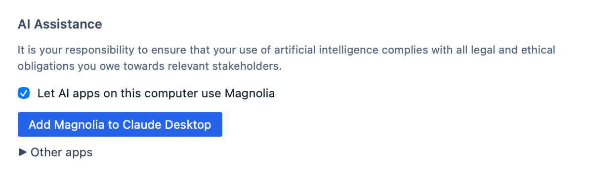
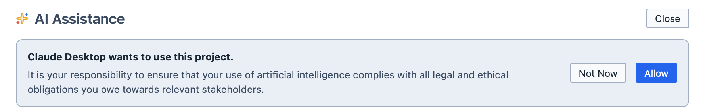
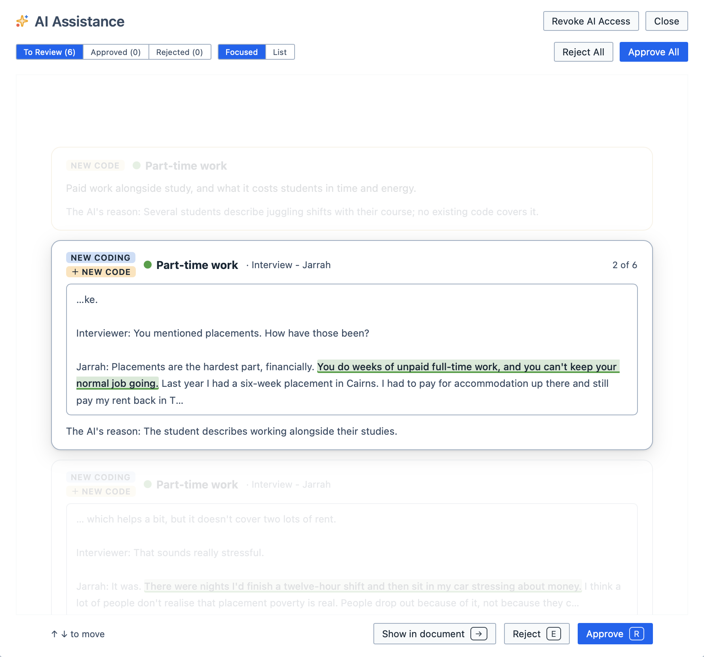
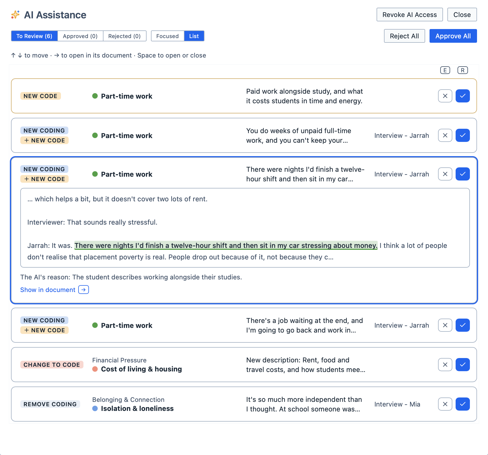
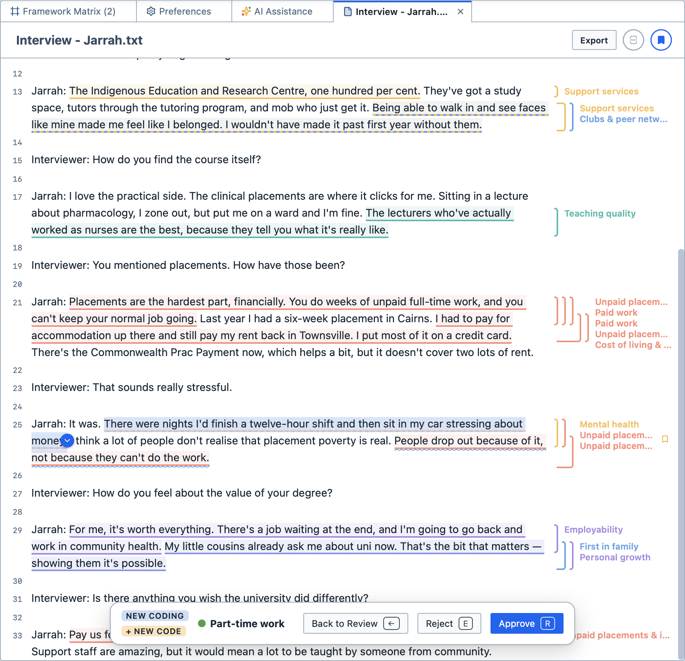

# AI Assistance

The AI Assistance tool allows you to ask an AI app on your computer, such as Claude Desktop, to suggest codes and codings for your project. Think of it as a research assistant who reads your data and leaves you suggestions: nothing changes in your project until you approve it.

Magnolia doesn't include an AI of its own. Instead, it lets an AI app you already use read the project you have open and propose changes, which then wait in Magnolia for you to approve or reject. If you have a Claude subscription, you can use it with Claude Desktop, with no other account or key. Other apps that support the Model Context Protocol (MCP) work too.

## Setting up

**To let AI apps use Magnolia:**

1. Click `Preferences` on the `Home` tab of the ribbon, and choose `AI Assistance`;
2. Tick `Let AI apps on this computer use Magnolia`;
3. Click `Add Magnolia to Claude Desktop`; and,
4. Quit and reopen Claude Desktop. Magnolia appears among its connectors.

<figure>
     
     <figcaption>AI Assistance in Preferences.</figcaption>
</figure>

::: tip
`Add Magnolia to Claude Desktop` only appears when Claude Desktop is installed. For another app, open `Other apps`, and copy the settings shown there into that app's settings for MCP servers.
:::

## Allowing a project

Each project is asked first. The first time an AI app tries to use a project, the AI Assistance tool tells you which app wants to use it. Click `Allow` to let it; or, `Not Now` to keep it out. Your choice is saved with the project.

<figure>
     
     <figcaption>An AI app asking to use the project.</figcaption>
</figure>

To stop AI apps from using a project, click `Revoke AI Access` at the top of the AI Assistance tool.

::: warning
An AI app sends what it reads to its own AI service. It is your responsibility to ensure that your use of artificial intelligence complies with all legal and ethical obligations you owe towards relevant stakeholders, such as your participants and your ethics approval.
:::

## Asking for suggestions

You ask for suggestions in the AI app itself, in your own words. For example:

- "Read the interviews in my Magnolia project, and suggest codes for the barriers students describe.";
- "Code every passage about cost with Financial pressure."; or,
- "Look at what is coded with Belonging, and suggest how to split it into narrower codes."

The app can read the project, and propose changes to it:

| The app can… | What it does |
| --- | --- |
| Read | List the documents and codes; read a document's text, or a survey's answers; search for words; and see the passages a code is applied to. |
| Propose | New codes (and codes under them); a new name, description or place for a code; codings; and removing codings. |

Pictures, and recordings without a transcript, have no text for the app to read.

::: info
The app can only propose. It can't change your project itself, so every change waits for you in the AI Assistance tool.
:::

## Reviewing suggestions

Click `AI Assistance` on the `View` tab of the ribbon (or choose `View` → `AI Assistance` in the menu bar) to open the AI Assistance tool. Its suggestions are under `To Review`; the ones you have decided are under `Approved` and `Rejected`.

Each suggestion has a badge:

| Badge | What it suggests |
| --- | --- |
| `New code` | A code to add, with its description. |
| `New coding` | Applying a code to a passage. |
| `Change to code` | Renaming a code, changing its description, or moving it under another code. |
| `Remove coding` | Removing a code from a passage. |

A `New coding` with `+ New code` underneath uses a code the app has suggested too. Approving the coding also approves that code; and, rejecting the code rejects its codings.

You can see the suggestions in two ways: `Focused`, one at a time; or, `List`, all at once.

<figure>
     
     <figcaption>Focused view: the suggestion in the middle is the one you are deciding.</figcaption>
</figure>

<figure>
     
     <figcaption>List view, with one suggestion opened to show the passage and the app's reason.</figcaption>
</figure>

**To review a suggestion:**

1. Move to it with `↑` and `↓`, or click it;
2. Read the passage and the app's reason (in `List` view, press `Space` to open it); and,
3. Click `Approve` (or press `R`); or, `Reject` (or press `E`).

`Approve All` and `Reject All` decide every suggestion at once.

| Key | What it does |
| --- | --- |
| `↑` `↓` | Move to the previous or next suggestion. |
| `R` or `Enter` | Approve it. |
| `E` or `Delete` | Reject it. |
| `→` | Open a coding in its document. |
| `Space` | Open or close a suggestion (`List` view). |

## Deciding in the document

To see a coding in context, click it, or press `→`. Its document opens with the passage highlighted, and a bar at the bottom shows the code. Click `Approve` (`R`) or `Reject` (`E`), and you are taken back to the AI Assistance tool, where you left off. Click `Back to Review` (or press `←`) to go back without deciding.

<figure>
     
     <figcaption>A suggested coding, in its document.</figcaption>
</figure>

## Undoing a decision

Approving a suggestion makes the change in your project, like any other change: `Undo` takes it back, and the suggestion returns to `To Review`. Every approved change is also recorded in the `Logbook`, with the app that proposed it.

If a change can't be made, for example because the passage's text has changed since the app read it, it moves to `Rejected` marked `Not made`, with the reason.
