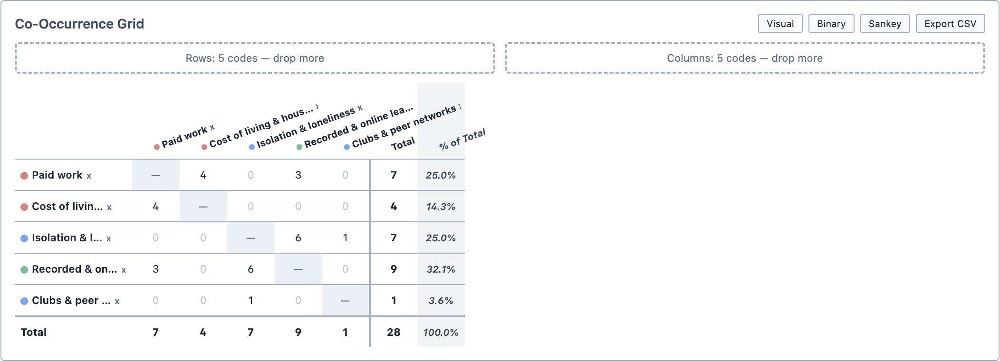
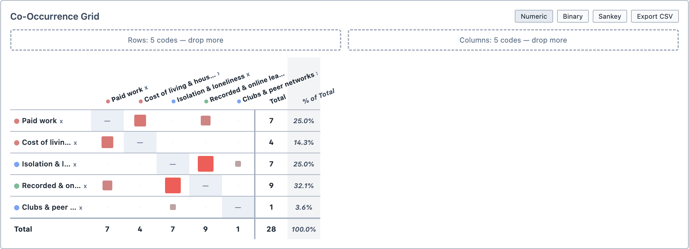
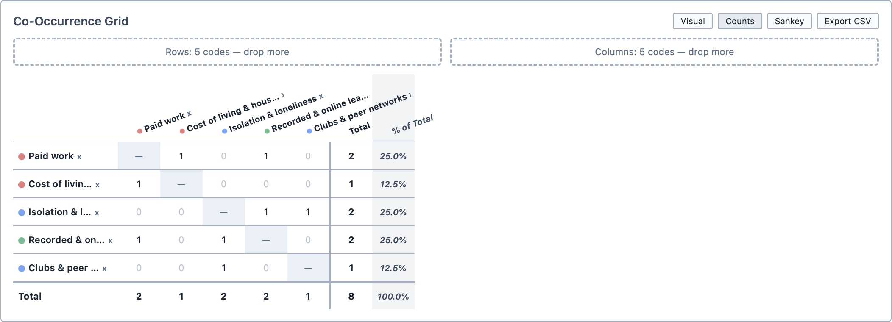
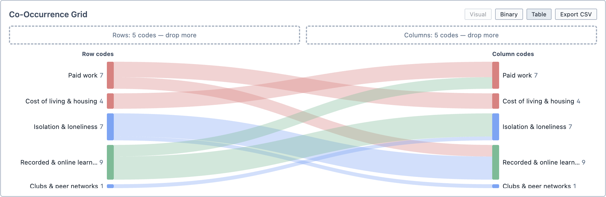

# Code Co-Occurrences

The Code Co-Occurrences tool allows you to see which codes overlap with each other. Codes make up both the rows and the columns of the table. Each cell counts the number of times the row's code and the column's code occur together.

Two codes occur together when:
- They are applied to the same selection; or,
- They are applied to selections that overlap.

**To open Code Co-Occurrences:**

1. Click the `Analyse` button in the toolbar.

2. Choose `Code Co-Occurrences`.

The tool contains the [Document Selector](/guide/documentselector).

## Adding codes

**To add codes to the table:**

1. Drag the codes from the Code Browser into either:
   1. The `Drop codes here for rows` box, to add them as rows;
   2. The `Drop codes here for columns` box, to add them as columns; or,
   3. Anywhere else in the `Co-Occurrence Grid`, to add them as both rows and columns.

2. The table fills in as you add codes.

3. To remove a code, click the `x` beside its name.

::: tip
Dropping the same codes into both the rows and the columns gives you every combination at once. Where a code meets itself, the cell shows a dash: a code always overlaps with itself, so it is not counted.
:::

## Reading the results

Each cell shows how many times the two codes occur together. The `Total` column and row add up the table, and the `% of Total` column shows each row's total as a percentage of the grand total.

<figure>
     
     <figcaption>The co-occurrence table, with the same five codes as both rows and columns.</figcaption>
</figure>

You can change how the results are displayed using the buttons above the table:

| Button | Output |
| --- | --- |
| `Visual` | Shows each cell as a coloured square, sized and shaded by its count. Click `Numeric` to return to numbers. |
| `Binary` | Shows `1` if the two codes ever occur together and `0` if they do not. Click `Counts` to return to counts. |
| `Sankey` | Shows the table as a Sankey diagram, linking each row's code to the codes it occurs with. Click `Table` to return to the table. |

<figure>
     
     <figcaption>The Visual view.</figcaption>
</figure>

<figure>
     
     <figcaption>The Binary view.</figcaption>
</figure>

<figure>
     
     <figcaption>The Sankey view.</figcaption>
</figure>

## Exploring the results

Click any cell with a count above zero to see where the two codes overlap. The overlapping selections appear in the Query Results pane.

- Clicking a row's `Total` shows every selection coded with that row's code.
- Clicking a column's `Total` shows every selection coded with that column's code.

## Saving and exporting

You can save the analysis by clicking `Save Analysis`. It appears in the Analyses Panel. If you make changes later, click `Update Analysis` to save them.

You can export the table as a spreadsheet by clicking `Export CSV`.

You can also add the analysis to a [Report](/guide/reports) by dragging it from the Analyses Panel into the report.
