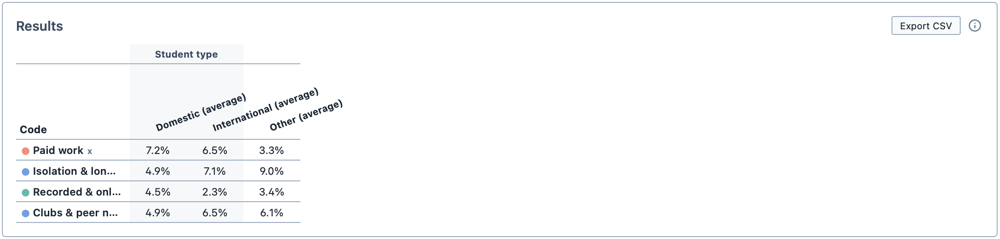
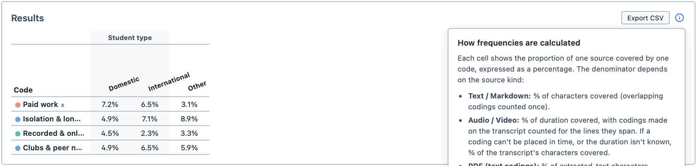
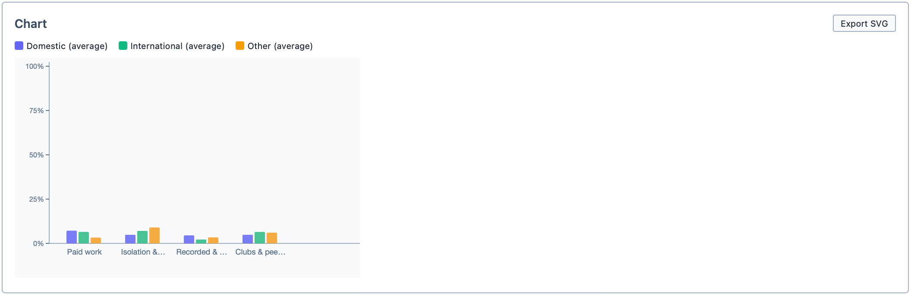

# Code Frequencies

The Code Frequencies tool allows you to see how much of each document is covered by each code. Codes make up the rows of the table, and documents make up the columns. Each cell shows the percentage of that document that is coded with that code.

Where [Codes in Documents](/guide/codesindocuments) counts *how many times* a code is applied, Code Frequencies measures *how much* of a document it covers. A single long passage and ten short ones can count very differently, but cover the same amount.

**To open Code Frequencies:**

1. Click the `Analyse` tab in the ribbon.

2. Click `Code Frequencies`.

The tool contains:
- The [Document Selector](/guide/documentselector)
- The [Grouped by](/guide/grouping) function

## Adding codes

**To add codes to the table:**

1. Drag the codes from the Code Browser into the `Results` box.

2. Each code appears as a row in the table, and a chart appears beneath it.

3. To remove a code, click the `x` beside its name.

## Reading the results

<figure>
     
     <figcaption>The frequency table, grouped by the Student type tag category.</figcaption>
</figure>

Each cell shows the percentage of that document covered by that code. Where selections coded with the same code overlap, the overlapping part is only counted once.

If you group your documents, a column that holds more than one document shows the average of its documents' percentages, and its heading is marked `(average)`. Each document counts equally, however long it is.

How the percentage is calculated depends on the type of document:

| Document type | Percentage of |
| --- | --- |
| Text | The characters in the document |
| Audio and video | The length of the recording (see below) |
| PDF (text selections) | The text in the PDF |
| PDF (box selections) | The area of all of the PDF's pages |
| Image | The area of the image |
| Survey | The text of the open-ended answers |

::: info
Images and box selections are measured by area. If a code's boxes cover half of an image, that code covers 50% of the image. If a code has both text and box selections in a PDF, its percentage is the average of the two. You can see these rules at any time by clicking the `ⓘ` button above the table.
:::

For audio and video, a coding made on the timeline counts for the time it covers. A coding made on the transcript counts for the transcript lines it covers, using the times of those lines. If any coding can't be placed in time, because the transcript has no timestamps, Magnolia measures the percentage of the transcript's text instead.

If Magnolia can't read the size of an image or a PDF's pages, or the length of a recording, from its file, it estimates it from what has been coded. The documents it has estimated are named below the table.

<figure>
     
     <figcaption>Clicking the ⓘ button explains how the percentages are calculated.</figcaption>
</figure>

The chart beneath the table shows the same results as a bar chart. Each code has a group of bars, with one bar for each document or group.

<figure>
     
     <figcaption>The bar chart.</figcaption>
</figure>

## Exploring the results

Click any cell, or any bar in the chart, to see the selections coded with that code in that document. The selections appear in the Query Results pane.

## Saving and exporting

You can save the analysis by clicking `Save Analysis`. It appears in the Saved Analyses Panel. If you make changes later, click `Update Analysis` to save them.

You can export the table as a spreadsheet by clicking `Export CSV`, and the chart as an image by clicking `Export SVG`.

You can also add the analysis to a [Report](/guide/reports) by dragging it from the Saved Analyses Panel into the report.
