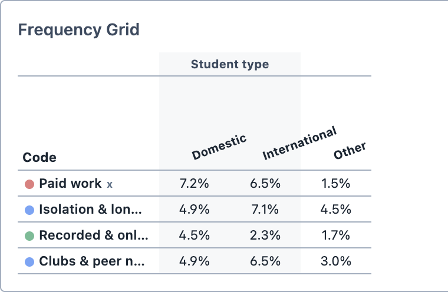
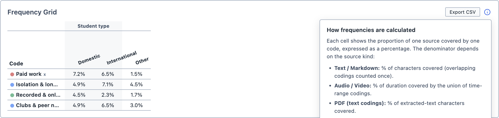
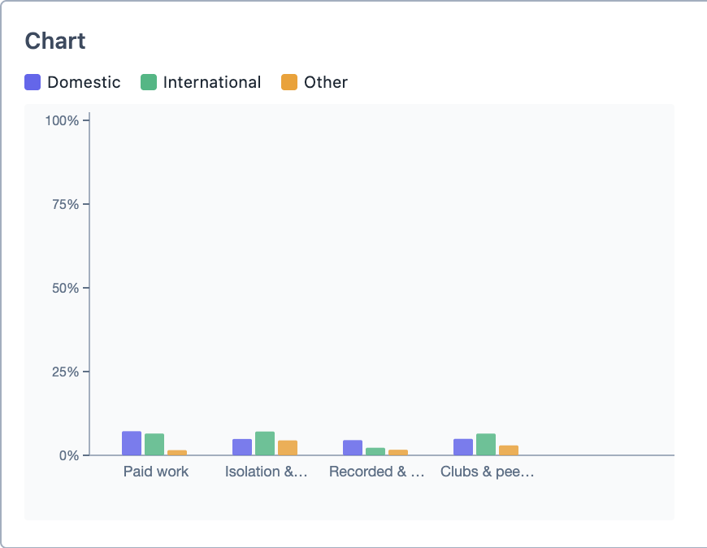

# Code Frequencies

The Code Frequencies tool allows you to see how much of each document is covered by each code. Codes make up the rows of the table, and documents make up the columns. Each cell shows the percentage of that document that is coded with that code.

Where [Codes in Documents](/guide/codesindocuments) counts *how many times* a code is applied, Code Frequencies measures *how much* of a document it covers. A single long passage and ten short ones can count very differently, but cover the same amount.

**To open Code Frequencies:**

1. Click the `Analyse` button in the toolbar.

2. Choose `Code Frequencies`.

The tool contains:
- The [Document Selector](/guide/documentselector)
- The [Group By](/guide/grouping) function

## Adding codes

**To add codes to the table:**

1. Drag the codes from the Code Browser into the `Frequency Grid` box.

2. Each code appears as a row in the table, and a chart appears beneath it.

3. To remove a code, click the `x` beside its name.

## Reading the results

<figure>
     
     <figcaption>The frequency table, grouped by the Student type tag category.</figcaption>
</figure>

Each cell shows the percentage of that document covered by that code. Where selections coded with the same code overlap, the overlapping part is only counted once.

How the percentage is calculated depends on the type of document:

| Document type | Percentage of |
| --- | --- |
| Text | The characters in the document |
| Audio and video | The length of the recording |
| PDF (text selections) | The text in the PDF |
| PDF (box selections) | The box selections in the PDF |
| Image | The box selections in the image |
| Survey | The text of the open-ended answers |

::: info
Images do not have a "length" in the way that text or recordings do, so Magnolia measures them by their selections instead. If an image has four box selections and one of them is coded with a code, that code covers 25% of the image. You can see these rules at any time by clicking the `ⓘ` button above the table.
:::

<figure>
     
     <figcaption>Clicking the ⓘ button explains how the percentages are calculated.</figcaption>
</figure>

The chart beneath the table shows the same results as a bar chart. Each code has a group of bars, with one bar for each document or group.

<figure>
     
     <figcaption>The bar chart.</figcaption>
</figure>

## Exploring the results

Click any cell, or any bar in the chart, to see the selections coded with that code in that document. The selections appear in the Query Results pane.

## Saving and exporting

You can save the analysis by clicking `Save Analysis`. It appears in the Analyses Panel. If you make changes later, click `Update Analysis` to save them.

You can export the table as a spreadsheet by clicking `Export CSV`, and the chart as an image by clicking `Export SVG`.

You can also add the analysis to a [Report](/guide/reports) by dragging it from the Analyses Panel into the report.
