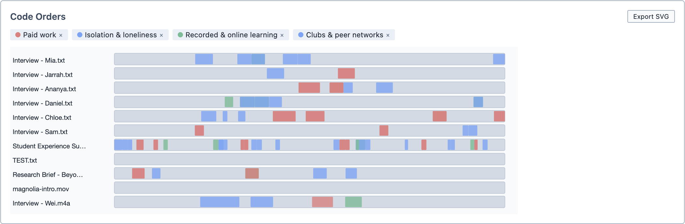
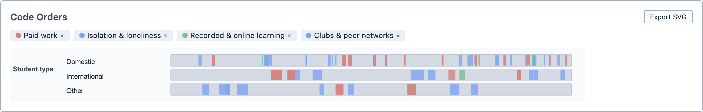

# Code Orders

The Code Orders tool allows you to see the order in which codes appear in each document. Each document is drawn as a strip, running from its beginning on the left to its end on the right. Coloured blocks show where each code appears along the way.

Think of it as a timeline for each document. It is particularly useful for interviews, where you can see whether a topic comes up early, late, or keeps returning.

**To open Code Orders:**

1. Click the `Analyse` button in the toolbar.

2. Choose `Code Orders`.

The tool contains:
- The [Document Selector](/guide/documentselector)
- The [Group By](/guide/grouping) function

## Adding codes

**To add codes to the visualisation:**

1. Drag the codes from the Code Browser into the `Code Orders` box.

2. Each code is shown in its own colour on every document's strip.

3. To remove a code, click the `×` on its label above the visualisation.

## Reading the results

Each row is one document. The further right a block sits, the later in the document that code appears.

<figure>
     
     <figcaption>Four codes across every document in the project.</figcaption>
</figure>

If you have used [Group By](/guide/grouping) to group documents by tag, the tagged documents are placed end to end on a single strip.

<figure>
     
     <figcaption>The same codes, grouped by the Student type tag category.</figcaption>
</figure>

Hover over a block to see the code's name and where it sits in the document, as a percentage of the way through.

## Exploring the results

Click a block to see the selections coded with that code in that document. The selections appear in the Query Results pane.

## Saving and exporting

You can save the analysis by clicking `Save Analysis`. It appears in the Analyses Panel. If you make changes later, click `Update Analysis` to save them.

You can export the visualisation as an image by clicking `Export SVG`.

You can also add the analysis to a [Report](/guide/reports) by dragging it from the Analyses Panel into the report.
