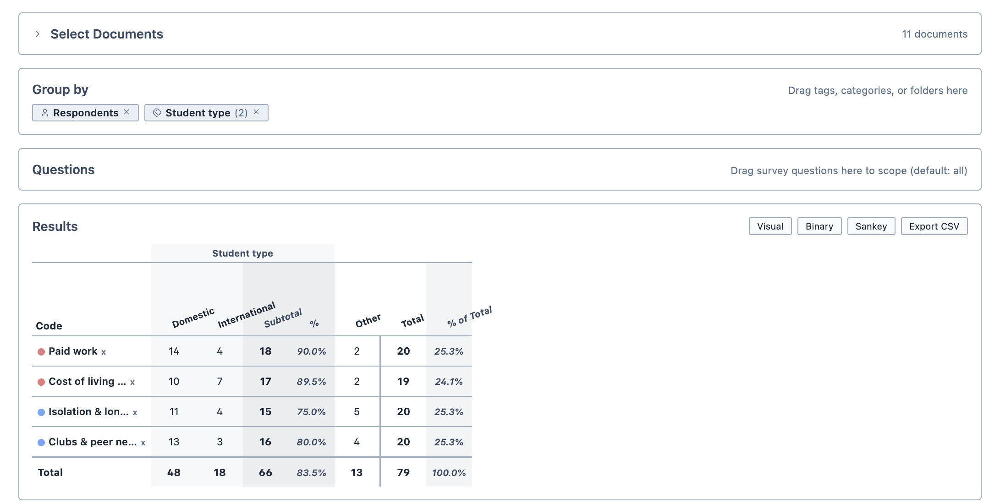
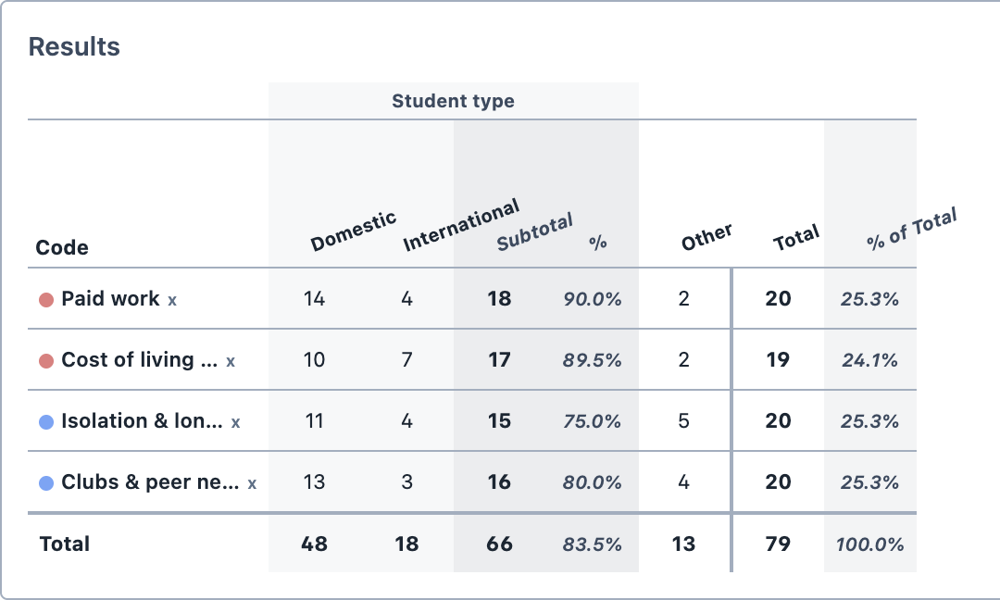
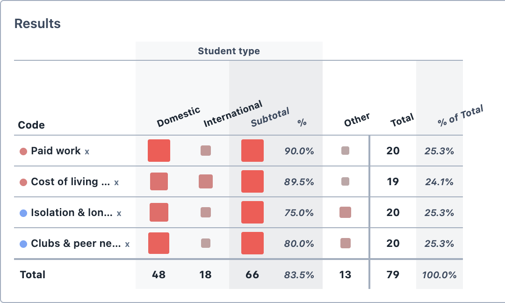
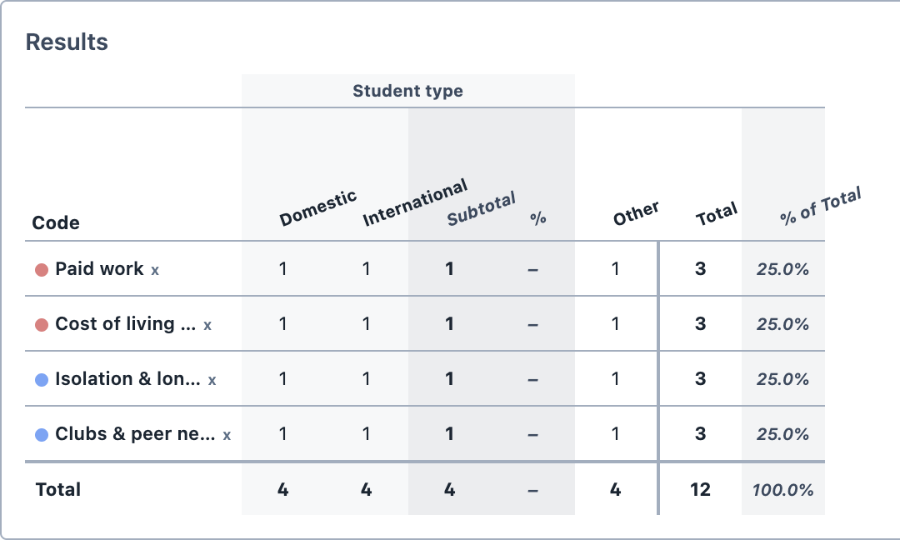
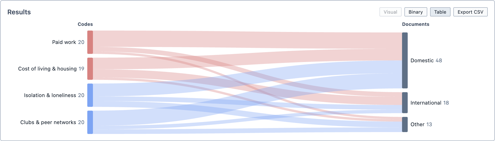

# Codes in Documents

The Codes in Documents tool allows you to see how often particular codes appear in any given set of documents. Codes make up the rows of the table, and documents make up the columns. Each cell counts the number of selections coded with that code in that document.

**To open Codes in Documents:**

1. Click the `Analyse` button in the toolbar.

2. Choose `Codes in Documents`.

The tool contains:
- The [Document Selector](/guide/documentselector)
- The [Group By](/guide/grouping) function

<figure>
     
     <figcaption>The Codes in Documents tool, with the results grouped by the Student type tag category.</figcaption>
</figure>

## Adding codes

**To add codes to the table:**

1. Drag the codes from the Code Browser into the `Results` box.

2. Each code appears as a row in the table. If you add both a code and its subcodes, the subcodes are indented beneath it.

3. To remove a code, click the `x` beside its name.

## Reading the results

Each cell shows how many selections in that document (or group of documents) are coded with that code.

- The `Total` column adds up each row, and the `Total` row adds up each column.
- The `% of Total` column shows each row's total as a percentage of the grand total.
- If you group by a tag category or a folder, its columns are followed by a `Subtotal` column and a `%` column. The `%` column shows the subtotal as a percentage of the row's total.

<figure>
     
     <figcaption>The results table.</figcaption>
</figure>

You can change how the results are displayed using the buttons above the table:

| Button | Output |
| --- | --- |
| `Visual` | Shows each cell as a coloured square, sized and shaded by its count. Click `Numeric` to return to numbers. |
| `Binary` | Shows `1` if the code appears in that document (or group of documents) and `0` if it does not. The totals then count how many documents (or groups) contain the code, rather than how many selections. Click `Counts` to return to counts. |
| `Sankey` | Shows the table as a Sankey diagram, with codes flowing into documents. Click `Table` to return to the table. |

<figure>
     
     <figcaption>The Visual view.</figcaption>
</figure>

<figure>
     
     <figcaption>The Binary view.</figcaption>
</figure>

<figure>
     
     <figcaption>The Sankey view.</figcaption>
</figure>

::: tip
Binary is useful when one long document would otherwise dominate your results. It answers the question "how many documents mention this?" rather than "how many times is this mentioned?".
:::

## Exploring the results

Click any cell with a count above zero to see its selections in the Query Results pane. Clicking a `Total` shows the selections for that whole row or column.

## Saving and exporting

You can save the analysis by clicking `Save Analysis`. It appears in the Analyses Panel. If you make changes later, click `Update Analysis` to save them.

You can export the table as a spreadsheet by clicking `Export CSV`.

You can also add the analysis to a [Report](/guide/reports) by dragging it from the Analyses Panel into the report.
