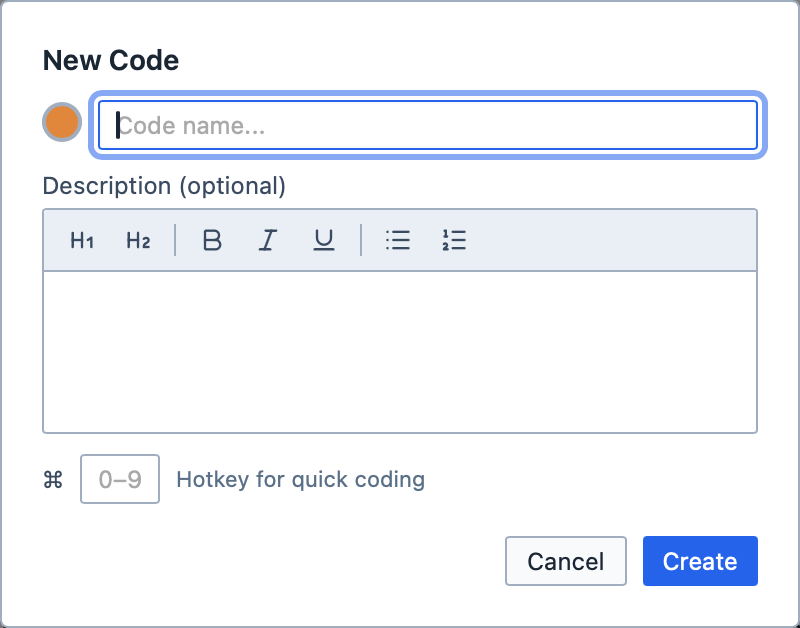
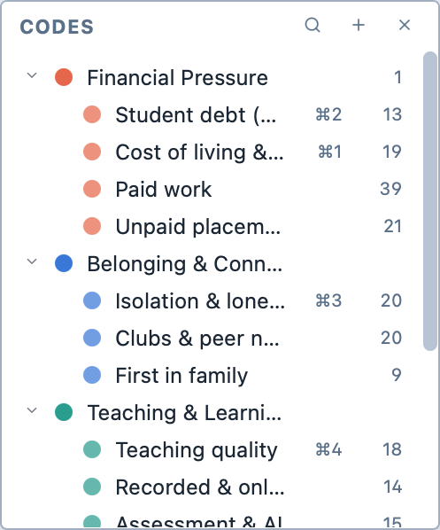
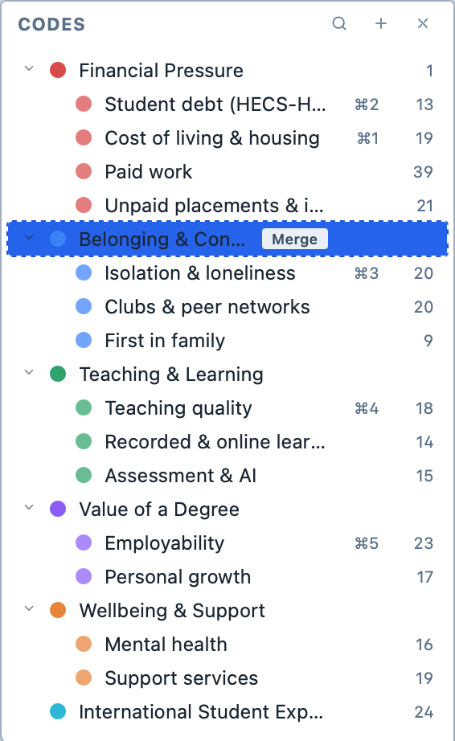
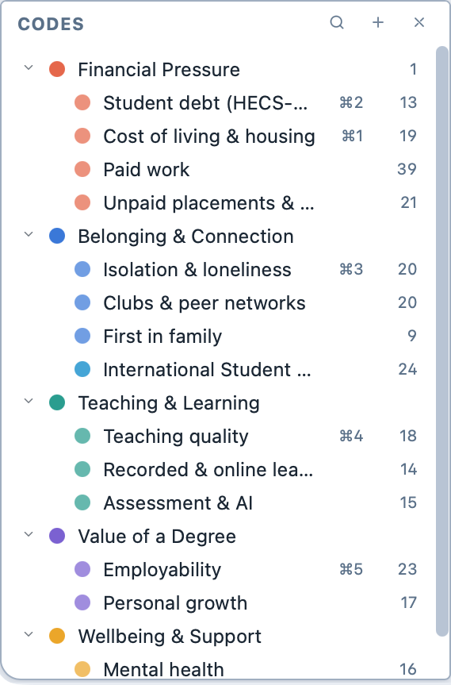
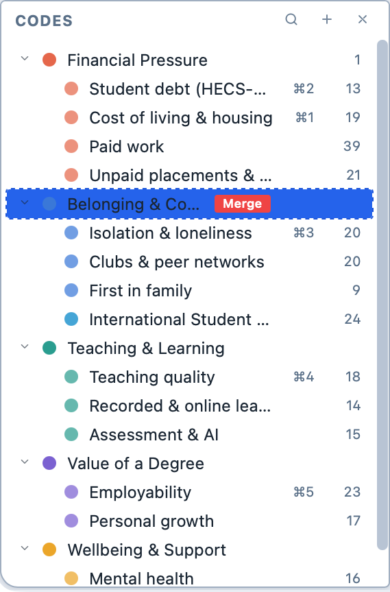
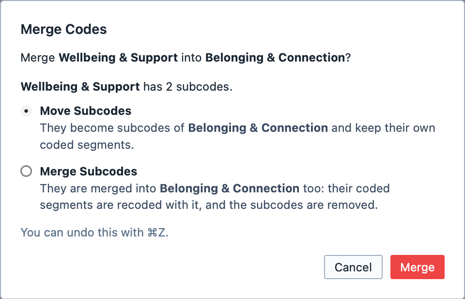
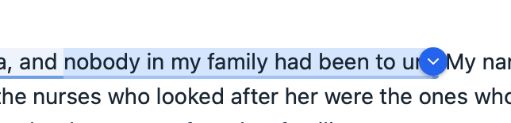
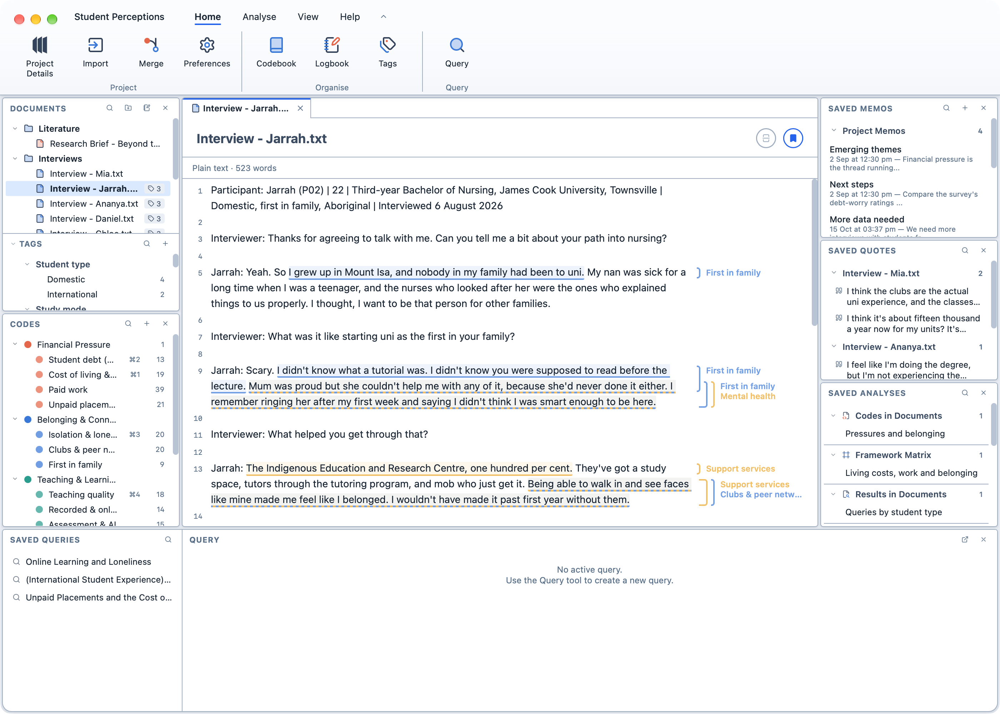
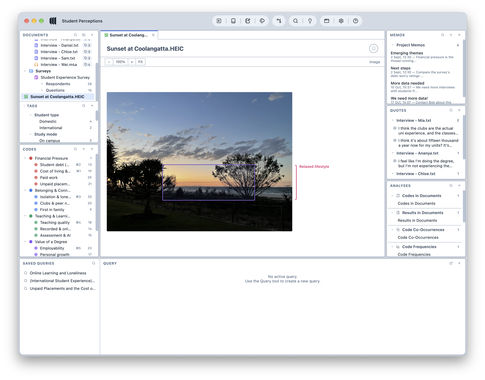
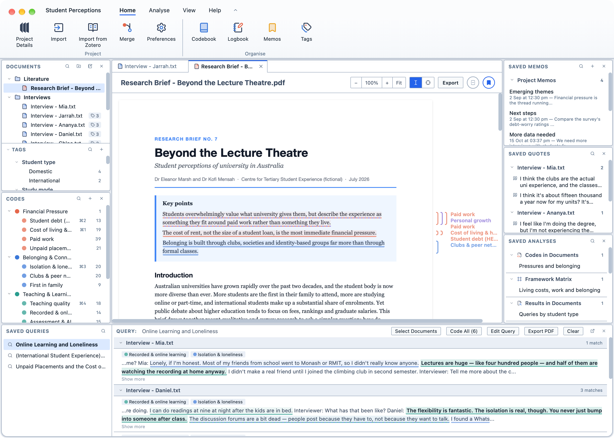

# Coding your data

Coding is the heart of qualitative analysis: you mark passages of your data and
attach a label—a *code*—to them. Think of it as having an infinite supply of
highlighters, where you can name them anything you want. Your desk is not big enough for that, but with Magnolia, it doesn't need to be because coding is done digitally.

## Creating codes

1. Press `+` in the Code Browser, or hit `⌘ + N` .

2. In the popup, enter the name of the code. You can also select a colour, give it a description, or assign a hotkey.

   <figure>
     
     <figcaption>The new code popup.</figcaption>
   </figure>

3. After clicking `Create`, your code appears in the Code Browser. You can create as many codes as you want.

   <figure>
     
     <figcaption>The code browser.</figcaption>
   </figure>

## Organising codes

As your coding develops, you will want to group related codes together. A code can sit under another code as a *subcode*; think of the codes above it as headings, and its subcodes as the more specific ideas that belong under them.

**To make a code a subcode of another code:**

1. Drag the code onto the code you want it to sit under. The code you are dropping onto is highlighted in blue.

   <figure>
     
     <figcaption>Dragging International Student Experience onto Belonging & Connection.</figcaption>
   </figure>

2. Let go. The code now appears beneath the other code, along with any subcodes of its own.

   <figure>
     
     <figcaption>International Student Experience is now a subcode of Belonging & Connection.</figcaption>
   </figure>

You can also right-click a code and choose `Add Child Code` to create a new subcode beneath it.

**To change the order of your codes:**

1. Drag a code to the top or bottom edge of another code. A line shows where it will go.

**To move a subcode back to the top level:**

1. Right-click the subcode and choose `Move to Top Level`; or,
2. Drag it onto an empty space in the Code Browser.

::: tip
You can select several codes with `⌘`-click or `⇧`-click and drag them together.
:::

## Merging codes

Sometimes you will find that two codes describe the same thing. Merging them combines them into one: everything coded with the first code is recoded with the second, and the first code is removed.

**To merge one code into another:**

1. Drag the code you want to merge over the code you want to keep. A `Merge` box appears beside it.

2. Drop the code on the `Merge` box, which turns red.

   <figure>
     
     <figcaption>Dropping a code on the Merge box beside Belonging & Connection.</figcaption>
   </figure>

3. Confirm by clicking `Merge`. If the code you are merging has subcodes, choose what happens to them first:

   | Option | What it does |
   |---|---|
   | `Move Subcodes` | The subcodes move under the code you are keeping, and keep their own coded segments. |
   | `Merge Subcodes` | The subcodes are merged in too: their coded segments are recoded with the code you are keeping, and the subcodes are removed. |

   <figure>
     
     <figcaption>Merging a code that has subcodes.</figcaption>
   </figure>

::: info
If a passage was coded with both codes, it keeps a single coding after the merge. Changed your mind? Press `⌘ + Z` to undo the merge.
:::

## Coding text

1. Select the text you wish to code in the Viewer. Then:
   1. Drag the code from the Code Browser to the Viewer; or,
   2. Click the button on the end of the selection, or right-click the selection, and choose the code under `Apply Code`; or,
   3. Press the hotkey assigned to the code.

   <figure>
     
     <figcaption>The button on the end of a selection.</figcaption>
   </figure>

2. Your code is assigned to the selection.

   <figure>
     
     <figcaption>Coded text.</figcaption>
   </figure>

3. You can continue to assign codes without having to reselect the text. They will be applied to the previous selection.

## Coding images

1. Click and drag on the image to create a selection. Then:
   1. Drag the code from the Code Browser to the Viewer; or,
   2. Click the button at the bottom-right corner of the selection, or right-click the selection, and choose the code under `Apply Code`; or,
   3. Press the hotkey assigned to the code.

2. Your code is assigned to the selection.

   <figure>
     
     <figcaption>A coded image.</figcaption>
   </figure>

3. You can continue to assign codes without having to reselect the selection. They will be applied to the previous selection.

## Coding PDFs with both text and images

1. You can switch between text selection and box selection using the toolbar in the Viewer.

   <figure>
     
     <figcaption>The PDF toolbar.</figcaption>
   </figure>

   <figure>
     
     <figcaption>A PDF containing coded text and images.</figcaption>
   </figure>

::: tip
Knowing how to code text, images, and documents with text an images is all you need to know to apply codes. Every other document type works on the same principles: transcripts and surveys, for example, are just text documents in disguise.
:::
