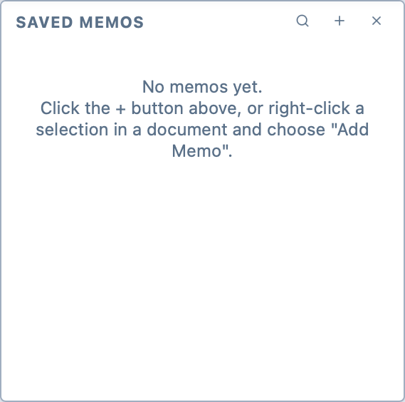
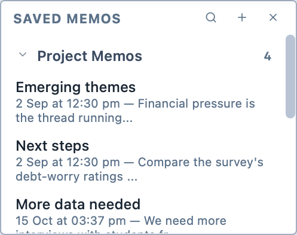
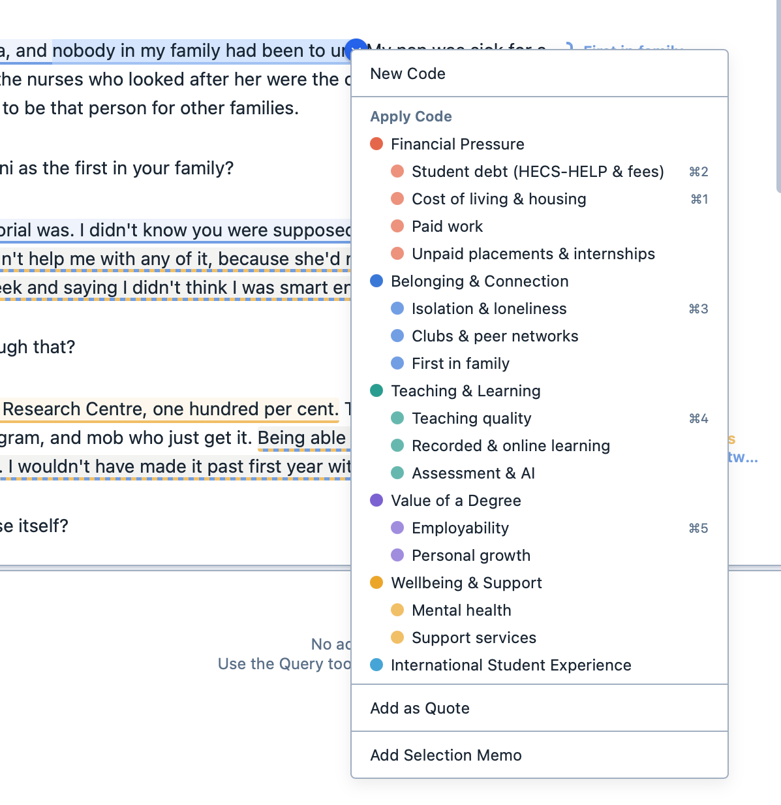

# Creating and deleting memos

The manner in which you create a memo changes depending on what you are attaching it to.

In all cases, memos can either be created by either:

- Clicking the ```+``` button in the Saved Memos Panel
- Right-clicking a selection and choosing ```Add Selection Memo```
- Clicking the Memo button.

::: tip
Only memos attached to the project as a whole are always visible in the Saved Memos panel. All other memos will only show when you have the document, query, or analysis to which they are attached  open in the Viewer. To see every memo in the project at once, use the [Memos window](#seeing-all-your-memos).
:::

## Project memos

Project memos are attached to the project as a whole. They are always visible in the Saved Memos Panel.

**To create a project memo:**

1. Click the ```+``` button in the Saved Memos Panel.

   <figure>
     
     <figcaption>The Saved Memos Panel, with no memos.</figcaption>
   </figure>

2. Choose ```Project Memo```.

3. Your project memo will appear in the Saved Memos Panel. It will be visible regardless of which document is active in the Viewer.

   <figure>
     
     <figcaption>The Saved Memos Panel.</figcaption>
   </figure>

## Selection memos

Selection memos are attached to segments in documents. These can be either selections of text or selections of images.

**To create a selection memo:**

1. Select the text or the part of the image you would like to attach the memo to.

2. Right-click on the selection and choose "Add selection memo".

   <figure>
     
     <figcaption>The contextual menu used to create a selection memo.</figcaption>
   </figure>

3. The memo appears in the Saved Memos Panel.

## All other memos

All other memos are attached to components of a project, such as analyses, documents, questions in surveys, or answers to surveys.

**To create any other memo:**

1. Click the memo button in the toolbar.

   <figure>
     
     <figcaption>The memo button.</figcaption>
   </figure>

2. The memo appears in the Saved Memos Panel. The memo button becomes coloured-in.

## Seeing all your memos

The Memos window lists every memo in the project, whatever it is attached to.

**To open the Memos window:**

1. Click the `Home` tab in the ribbon.

2. Click `Memos`.

The memos are grouped by what they are attached to: the project, each document, saved queries, saved analyses and relationship maps. Under each memo, you can see what it is attached to (for a selection memo, the start of the selected text) and when it was last changed. Click a group's name to fold it away.

Click a memo to read it on the right. From there:
- Click `Edit` to change the memo. You can also double-click the memo in the list; or,
- Click `Show` to see where the memo is attached in the main window. For a selection memo, the document opens at the selected text.

Type in the `Search memos` box to find memos by their title, their text, or what they are attached to.

Click the `+` button to write a new project memo. Click `Export PDF` to save every memo, in its groups, as a PDF.

## Deleting memos
**To delete a memo:**

1. Right-click the memo in the Saved Memos Panel or the Memos window.

2. Choose ```Delete Memo```.

In the Memos window, you can delete several memos at once. Hold down `Shift` or `⌘` (`Ctrl` on Windows and Linux) while you click to select them, then right-click one of them.
