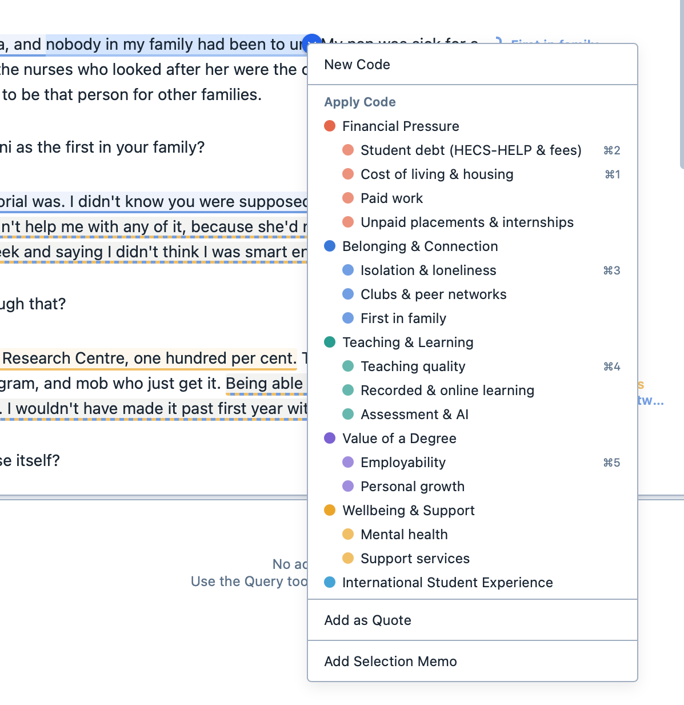
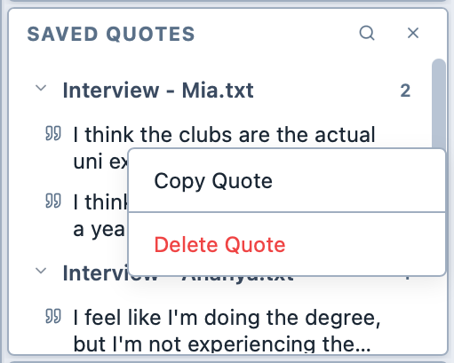

# Creating quotes

To create a quote:

1. Select the text or the part of the image you wish to quote.

2. Then:
   1. Right-click on the selection and choose "Add as quote"; or,
   2. Drag the grab handle on the selection into the Saved Quotes Panel. The panel is outlined in blue as you drag over it.

   <figure>
     
     <figcaption>Adding a quote.</figcaption>
   </figure>

3. The quote appears in the Saved Quotes Panel.

   <figure>
     
     <figcaption>The Saved Quotes Panel.</figcaption>
   </figure>

4. You can right-click on a quote in the Saved Quotes Panel to copy it to the clipboard or delete it.

   <figure>
     
     <figcaption>The Saved Quotes Panel contextual menu.</figcaption>
   </figure>
