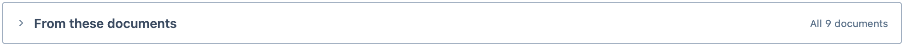
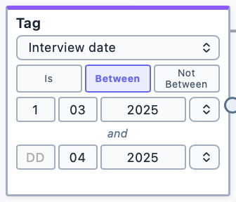
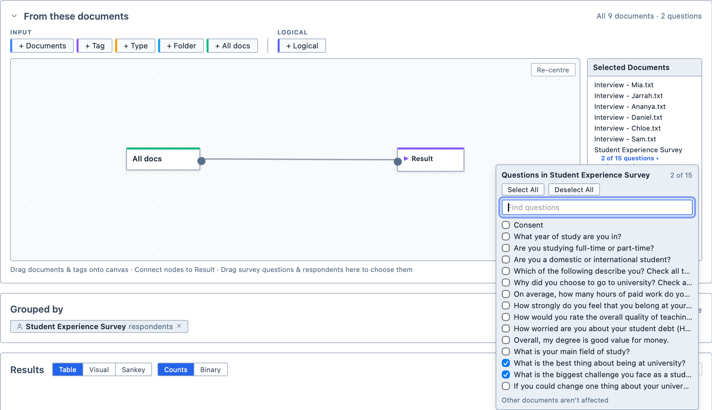

# Document Selector

The Document Selector is a function common to the query tool and several analysis tools. It allows you to select which documents your query or analysis applies to. In each tool, it is the `From these documents` section.

## Default state
By default, the Document Selector is collapsed and targets all documents in your project. Its heading shows what it targets, so you can check without opening it: for example, `All 9 documents`, or `4 of 9 documents · 2 questions` once you have narrowed it down.
<figure>
     
     <figcaption>The Document Selector in its default state.</figcaption>
</figure>

## Inputs
You can select which documents your query or analysis applies to by:
- Documents
- Tags
- Document types (video, audio, image, document, survey)
- Folder

::: tip
You cannot simply drag documents directly from the Document Browser onto the Document Selector canvas. Instead, they must be dropped into a pre-existing Document node box on the canvas.
:::

## Tags with dates
A tag node can select documents by a range of dates, such as every interview from March to April 2025. When you choose a date category, the node offers `Is`, `Between` and `Not Between`.

**To select documents between two dates:**

1. Add a `Tag` node and choose a date category;
2. Click `Between`, or `Not Between` to leave those dates out; and,
3. Type each date in the `DD`, `MM` and `YYYY` boxes; or,
4. Pick a date already used in that category from the menu beside each date.

<figure>
     
     <figcaption>Selecting documents dated between 1 March and the end of April 2025.</figcaption>
</figure>

You can leave out the day, or the day and the month. A year on its own covers the whole year, so `Between` 2024 and 2025 runs to the end of 2025. Leave one date empty to select everything from, or up to, the other date.

Dates are listed newest first.

::: tip
If a date is not a real date, such as 31/02/2025, its boxes turn red.
:::

## Operators
You can add logical operators into your document selection to refine it. Magnolia uses these logical operators:

| Operator | Output |
| --- | --- |
| Union | Selects documents from Input 1 and Input 2 |
| Intersect | Selects documents where both Input 1 and Input 2 are met | 
| Subtract | Selects documents where Input 1 is met but Input 2 is not met | 

::: tip
You can use the output of any logical operator as the input to another logical operator.
:::

<figure>
     
     <figcaption>The Document Selector with a completed selection, targeting "all books by Richard Flanagan".</figcaption>
</figure>

## Selected documents list
For convenience, the Document Selector shows you which documents your selection targets.

::: tip
Remember to connect your selection to the Result node box.
:::

## Survey questions and respondents
If your selection includes a survey, you can limit it to some of the survey's questions or respondents. Think of it as choosing which columns and rows of the survey's spreadsheet to read.

Each survey in the Selected Documents list shows two lines beneath its name: `All questions` and `All respondents`.

**To choose questions or respondents:**

1. Click `All questions` or `All respondents` beneath the survey's name.

2. Tick the questions or respondents you want to include. Use `Select All` and `Deselect All` to tick or clear them all at once; and,

3. Click outside the list to close it. The line now shows how many you have chosen, for example `2 of 14 questions`.

<figure>
     
     <figcaption>Choosing two of a survey’s questions.</figcaption>
</figure>

You can also drag questions or respondents from the Document Browser onto the Document Selector. Each one you drop is added to its survey's choices.

The choices only apply to that survey. Other documents in your selection are not affected.

::: tip
If you deselect every question or respondent, the line shows `No questions` or `No respondents`, and nothing from that survey is included. To leave a survey out entirely, it is clearer to remove it from your selection.
:::
