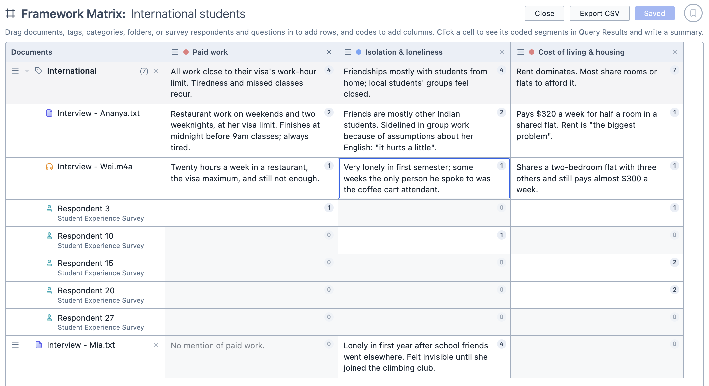
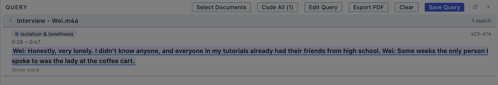

# Framework Matrix

The Framework Matrix allows you to build a table with documents as the rows and codes as the columns, and write your own summary in each cell of what that code looks like in that document. It is a good way to condense a large amount of coded data into a single overview, and to compare different sources side by side.

<figure>
     
     <figcaption>A Framework Matrix.</figcaption>
</figure>

**To open the Framework Matrix:**

1. Click the `Analyse` button in the toolbar.

2. Choose `Framework Matrix`.

You can also start a matrix from the [Codes in Documents](/guide/codesindocuments#opening-as-a-framework-matrix) tool by clicking `Open as Framework Matrix`. The matrix opens with the same codes and documents already added.

## Adding rows

**To add rows to the matrix:**

1. Drag any of the following from the Document Browser into the matrix:
   - Documents
   - Survey respondents
   - Survey questions
   - Tags
   - Tag categories
   - Folders

2. A document, respondent or question becomes a single row. A tag, tag category or folder becomes a group, with its contents nested beneath it.

| You drag in | The group contains |
| --- | --- |
| A tag | Every document with that tag, plus any survey respondents and questions with that tag |
| A tag category | A sub-group for each tag in the category |
| A folder | Every document in the folder, including documents in its subfolders |

::: info
Groups stay up to date with your project. If you tag a document or add it to a folder after adding the tag or folder to the matrix, the document appears in the group. If a document loses the tag or folder after you have written a summary for it, it stays in the matrix but is marked as no longer having that tag or folder, so your summary isn't lost. You can click the `×` beside it to remove it.
:::

::: tip
A document can appear in more than one group (for example, if it has two of the tags you have added). It shares one set of summaries wherever it appears, so typing in one place updates the others.
:::

## Adding columns

**To add columns to the matrix:**

1. Drag the codes from the Code Browser into the matrix.

2. Each code appears as a column.

Each column covers segments coded with that code only. If you would like to include a code's subcodes, add them as columns of their own.

## Writing summaries

**To write a summary:**

1. Click a cell. The coded segments for that code in that row appear in the Query Results pane.

   <figure>
     
     <figcaption>Clicking a cell shows the segments coded with it in the Query Results pane.</figcaption>
   </figure>

2. Type your summary into the cell.

The number in the corner of each cell shows how many coded segments it covers. Cells with no coded segments are faded, but you can still write in them, for example to note that something isn't mentioned.

Rows for groups have cells of their own. Clicking one shows the coded segments from every row in the group, so you can use these cells to summarise the group as a whole.

## Rearranging the matrix

You can move a row or column in the matrix by dragging it by the `≡` handle.

To remove a row or column, click the `×` beside it. If you have written summaries for it, Magnolia asks before deleting them.

## Saving and exporting

You can save the matrix by clicking `Save Analysis`. It appears in the Analyses Panel under Framework Matrix. Once saved, your changes are saved automatically as you work.

You can export the matrix as a spreadsheet by clicking `Export CSV`.
