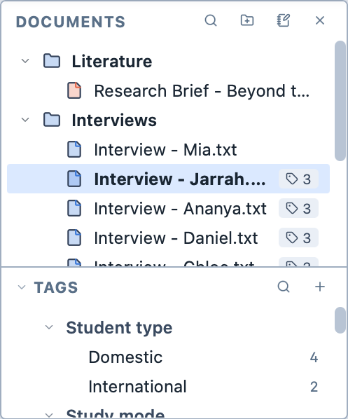
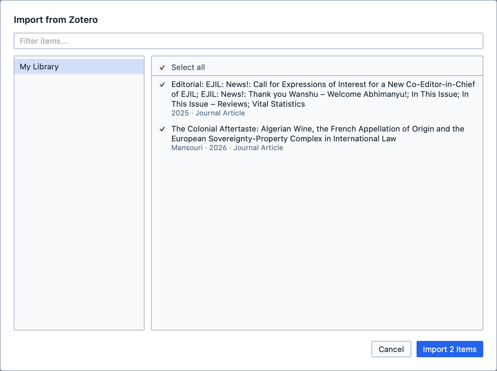

# Importing documents

**To import a document into Magnolia:**
1. Drag the document from your computer onto Magnolia's main window; or,
2. Click `Import` on the `Home` tab of the ribbon.

The document appears in the Document Browser.

<figure>
     
     <figcaption>The Document Browser.</figcaption>
</figure>

## Importing from Zotero

If you keep your literature in [Zotero](https://www.zotero.org), you can import it straight into Magnolia, with each item's details attached as tags. Think of it as bringing your reference library into your project, ready to code.

Magnolia reads Zotero's library from the Zotero app on your computer, so Zotero must be open while you import. Magnolia needs Zotero 7 or later.

::: info
The first time, Zotero must allow Magnolia to read its library. In Zotero, open `Settings`, choose `Advanced`, and tick `Allow other applications on this computer to communicate with Zotero`. If it isn't ticked, Magnolia tells you so.
:::

**To import from Zotero:**

1. Open Zotero;
2. Click `Import from Zotero` on the `Home` tab of the ribbon;
3. Choose a library and a collection on the left, or type in `Filter items...` to find items;
4. Tick the items you want, or `Select all`; and,
5. Click `Import`.

<figure>
     
     <figcaption>Choosing items to import from Zotero.</figcaption>
</figure>

Each item comes in as a document in a folder called `Zotero` in the Document Browser, named after the item's title in Zotero. Magnolia imports the item's file, such as its PDF; items without a file, or with a kind of file Magnolia can't import, can't be ticked, and the list says why.

Magnolia also brings across the item's details:

| From Zotero | In Magnolia |
| --- | --- |
| Item type, creators and every other field (publication, date, DOI and so on) | A tag in a tag category of the same name, such as `Author` or `Date`. Magnolia uses the categories and tags your project already has, and makes the ones it is missing. Dates become date tags. |
| Zotero's own tags | Tags in a `Zotero Tags` category. |
| Collections | Tags in a `Collection` category. |
| The abstract and any notes | Document memos on the document. |

Items you have already imported show `already in the project`, so you don't import them twice.

::: tip
Because every item's details are tags, you can select documents by author, year or journal in the [Document Selector](/guide/documentselector), or [group results](/guide/grouping) by them.
:::

