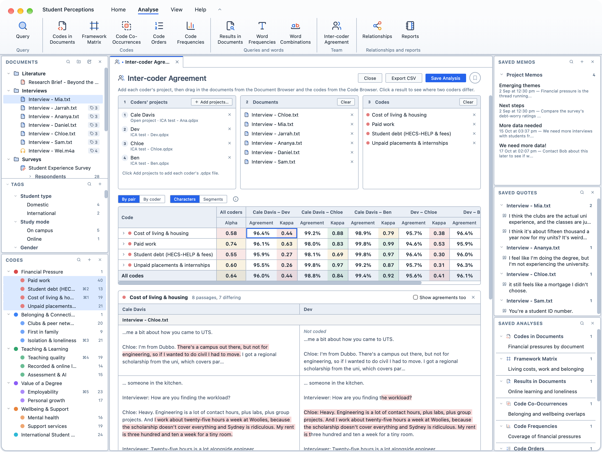
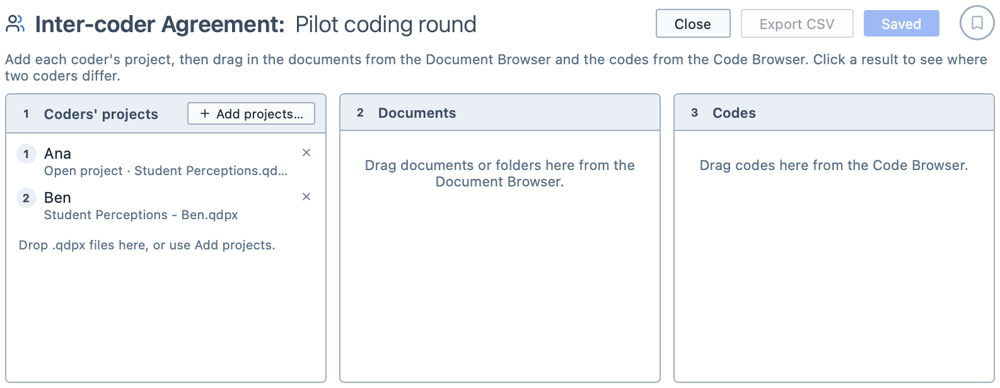
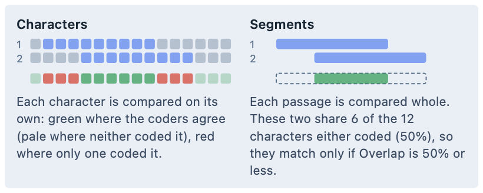
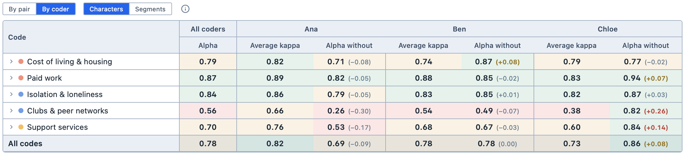
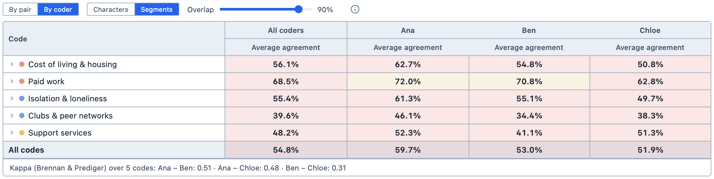
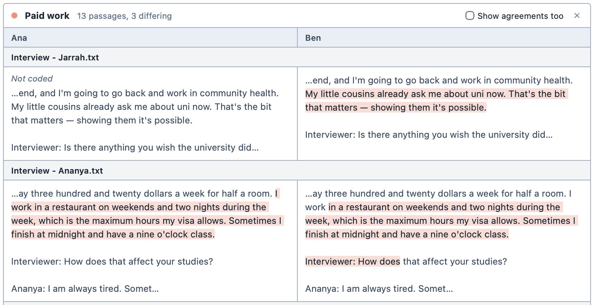
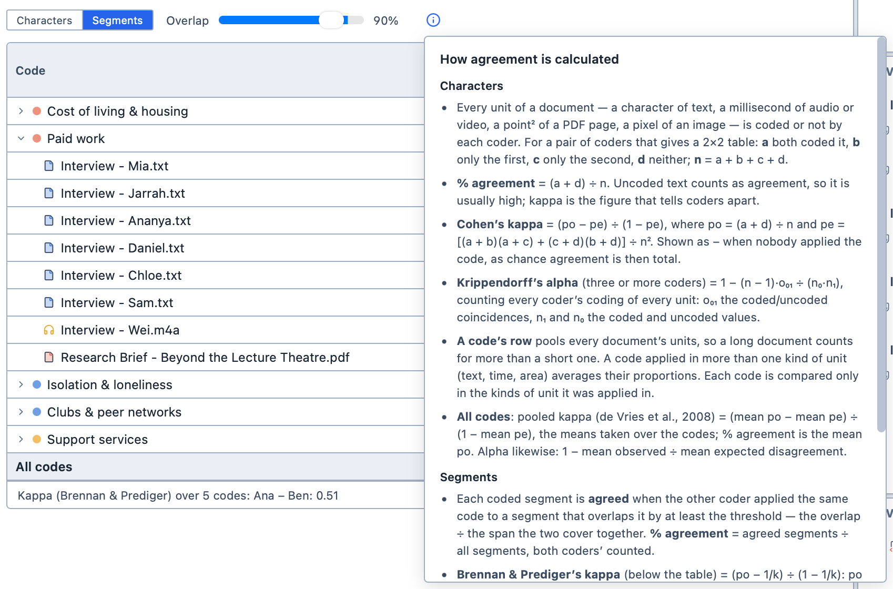
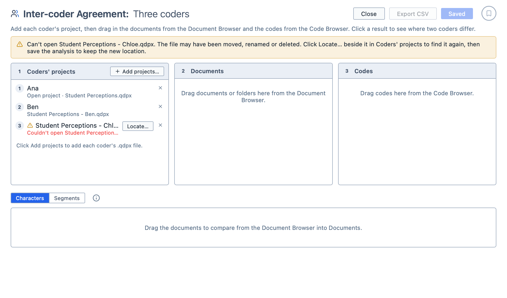

# Inter-coder Agreement

The Inter-coder Agreement tool allows you to compare how two or more people have coded the same documents. Each coder works in their own copy of the project, and Magnolia lines the copies up side by side: for each code, it shows how closely the coders agree, and lets you see exactly where they differ.

Think of it as laying two highlighted copies of the same interview on the table next to each other, but for every document and every code at once.

<figure>
     
     <figcaption>The Inter-coder Agreement tool.</figcaption>
</figure>

Checking agreement is a common step in team projects. It shows whether a codebook is clear enough for different people to apply it in the same way, and points you to the codes and passages worth discussing.

## Before you start

Each coder needs their own copy of the same project. The easiest way is to set up the project once (import the documents and create the codebook), then give each coder a copy of the `.qdpx` file to code on their own computer.

Magnolia matches the copies up for you:
- Documents are matched when they are the same document in each copy, or when they have the same name and type; and,
- Codes are matched when they are the same code in each copy, or when they have the same name in the same place in the code tree.

::: tip
Agree on the codebook before anyone starts coding, and write a short description of each code. If a coder renames a code or moves it to another place in the tree, Magnolia treats it as a different code.
:::

Each coder is named after the person who last saved their file, as entered in `Preferences`. The project you have open is named after you.

Coders can code any kind of document: text, PDFs (their text or boxes drawn on the page), images, surveys, and audio and video (their transcript or the timeline).

**To open the Inter-coder Agreement tool:**

1. Click the `Analyse` tab in the ribbon.

2. Click `Inter-coder Agreement`, in the `Team` group.

## Setting up the comparison

The tool is set up in three boxes, from left to right.

<figure>
     
     <figcaption>The coders' projects, ready for documents and codes to be added.</figcaption>
</figure>

### 1. Coders' projects

The project you have open is already in the list.

**To add another coder's project:**

1. Click `Add projects…`.

2. Choose one or more `.qdpx` files, and click `Open`.

To remove a project, click the `x` beside it.

### 2. Documents

**To choose the documents to compare:**

1. Drag the documents from the Document Browser into the `Documents` box. You can also drag a folder to add every document in it, including those in its subfolders.

2. To remove a document, click the `x` beside it, or click `Clear` to remove them all.

Click a document to see which projects contain it. The projects that have it are highlighted in the first box. A document that is missing from some projects shows how many it is in (for example, `2/3`), and one that is only in a single project can't be compared.

::: info
If a document's text is not the same in every project (for example, because a coder edited it), Magnolia marks it with a warning sign. Its text codings can't be compared, because the same position no longer points to the same words. Its time ranges and box selections are still compared.
:::

### 3. Codes

**To choose the codes to compare:**

1. Drag the codes from the Code Browser into the `Codes` box.

2. To remove a code, click the `x` beside it, or click `Clear` to remove them all.

Each code is compared on its own. If you would like to include a code's subcodes, add them as codes of their own.

## Characters or Segments?

The results appear beneath the three boxes as soon as there are two projects, a document and a code. There are two ways to compare coders, and you can switch between them at any time with `Characters` and `Segments`.

<figure>
     
     <figcaption>The same two codings, compared both ways.</figcaption>
</figure>

- `Characters` goes through the documents piece by piece (every character of text, every moment of a recording, every point of a page or image) and asks whether both coders coded it the same way. Exactly where a passage starts and stops matters.

- `Segments` takes the coded passages one at a time and asks whether the other coder coded the same passage with the same code. Small differences at a passage's edges don't matter, within the `Overlap` you choose.

| | Characters | Segments |
| --- | --- | --- |
| Compares | Every part of every document | Each coded passage, as a whole |
| Main figures | Kappa, and alpha for three or more coders | % of passages matched |
| Good for | Reporting a single, widely recognised figure | Finding the passages worth discussing |
| Sensitive to | Where passages start and stop | The `Overlap` you choose |

Many teams use both: `Characters` for the figures they report, and `Segments` to see which passages the coders disagreed about.

## Reading the results: Characters

<figure>
     
     <figcaption>Comparing two coders, character by character.</figcaption>
</figure>

For each pair of coders, the table shows:

| Column | What it shows |
| --- | --- |
| `Agreement` | How much of the documents both coders treated the same way: they both applied the code, or both left it out. |
| `Kappa` | How well the two coders agree, after allowing for the agreement you'd expect by luck alone (Cohen's kappa). 1 is complete agreement, and 0 is no better than luck. |

::: tip
`Agreement` is nearly always very high, because the parts of a document that neither coder applied the code to count as agreement too. In the example above, every code is above 98%. `Kappa` takes this into account, so it is the figure to look at, and the one to report.
:::

`Kappa` cells are shaded to help you spot weak agreement. `Agreement` isn't shaded, because it is always high.

| Shade | Kappa |
| --- | --- |
| Green | 0.80 or more |
| Amber | 0.60 to 0.79 |
| Red | Below 0.60 |

A kappa of `–` means that neither coder applied the code, so there is nothing to compare.

Hover over any column heading to see what it shows.

### Results for each document

Click the `>` beside a code to see its results in each document.

<figure>
     
     <figcaption>The results for one code, document by document.</figcaption>
</figure>

A code's own row brings all the documents together, so a long document counts for more than a short one.

### All codes

The `All codes` row brings every code together into a single figure for each pair of coders. Each code counts equally, however much it was used.

## Reading the results: Segments

`Segments` compares the coded passages themselves. A passage agrees when the other coder applied the same code to a passage that overlaps it closely enough. You choose how closely with the `Overlap` slider: at 90%, the part the two passages share must be at least 90% of everything they cover together.

For example, say one coder codes words 1 to 10 and the other codes words 2 to 10. They share 9 of the 10 words they cover together (90%), so they agree when `Overlap` is 90% or lower. If the other coder had coded words 1 to 20, they would share 10 of 20 words (50%), and would only agree with `Overlap` at 50% or lower.

<figure>
     
     <figcaption>Comparing coded segments, with Paid work shown for each document.</figcaption>
</figure>

| Column | What it shows |
| --- | --- |
| `Agreed` | How many of the two coders' passages the other coder also coded in nearly the same place. |
| `Segments` | How many passages the two coders coded between them. |
| `Agreement` | The agreed passages as a percentage of all the passages. |

In the example above, Ana and Ben coded 25 passages of Paid work between them, and 20 of those were matched by the other coder: an agreement of 80%.

`Agreement` cells are shaded:

| Shade | Agreement |
| --- | --- |
| Green | 80% or more |
| Amber | 70% to 79% |
| Red | Below 70% |

Beneath the table is Brennan and Prediger's kappa for each pair of coders, worked out over all the codes you have chosen. It reads like the kappa for `Characters`, but counts passages.

::: tip
`Overlap` makes a big difference. At 90%, coders must mark almost exactly the same stretch, so coders who agree about what a passage means but start it a clause apart will disagree. Try lowering `Overlap` to 60% or 70%: if agreement rises a lot, the coders mostly differ about where passages begin and end, not about what they mean. Whichever you choose, report it alongside your results.
:::

## Three or more coders

With three or more coders, you can look at the results in two ways, by choosing `By pair` or `By coder`.

### By pair

`By pair` compares every pair of coders, with an `All coders` column first:
- With `Characters`, `All coders` shows `Alpha` (Krippendorff's alpha): how well all the coders agree together, after allowing for agreement by luck. It reads like kappa, and is shaded the same way.
- With `Segments`, `All coders` shows `Average agreement`: the average of every pair's agreement, with each pair counting equally.

<figure>
     
     <figcaption>Comparing three coders, pair by pair.</figcaption>
</figure>

The `All coders` column stays in place when you scroll the table sideways, so you can always compare a pair with the group.

### By coder

`By coder` compares each coder with all the others, so you can see whether one coder is coding differently from the rest of the team.

<figure>
     
     <figcaption>Comparing each coder with the others, character by character.</figcaption>
</figure>

With `Characters`, each coder has two columns:

| Column | What it shows |
| --- | --- |
| `Average kappa` | How well this coder agrees with the others on average: the average of their kappa with each other coder. |
| `Alpha without` | How well the other coders agree among themselves when this coder is left out. Beside it, in brackets, is how much that differs from the `All coders` alpha. |

The figure in brackets is the one to watch. A plus means the others agree better without this coder:

| Colour | Change | What it suggests |
| --- | --- | --- |
| Red | +0.10 or more | This coder is clearly out of step with the others. |
| Amber | +0.05 to +0.09 | Worth a look. |
| Grey | Less than +0.05 | This coder is in line with the others. Small changes are usually down to chance. |

For example, look at Clubs & peer networks above. Alpha for all three coders is 0.56. Without Chloe, it rises to 0.82 (+0.26): Ana and Ben agree well with each other, and Chloe codes this code differently. Without Ana, it falls to 0.26 (−0.30), which shows that Ana is the coder the others agree with most. Chloe's average kappa, 0.38, is also the lowest of the three.

::: info
The shading of `Alpha without` describes the other coders: it shows how well they agree among themselves, on the same scale as alpha. Whether this coder is out of step is shown by the colour of the figure in brackets.
:::

With `Segments`, each coder has one column, `Average agreement`: the average of their agreement with each other coder. It is shaded like `Agreement` for `Segments`.

<figure>
     
     <figcaption>Comparing each coder with the others, by segments.</figcaption>
</figure>

To see where a coder differs, switch to `By pair` and click their results with the other coders (see below).

## How good is good enough?

There is no single rule, but these are common guides:

| Figure | Strong | Acceptable | Worth discussing |
| --- | --- | --- | --- |
| Kappa and alpha | 0.80 or more | 0.60 to 0.79 | Below 0.60 |
| Segment agreement | 80% or more | 70% to 79% | Below 70% |

The table's colours follow these bands. Bear in mind that:
- Segment agreement depends heavily on `Overlap`, so always report the `Overlap` you used;
- A code that was used only a few times can swing a long way on one or two passages, so look at how much it was used before drawing conclusions; and,
- The figures tell you where coders differ, not who is right. A coder who is out of step may have spotted something the others missed.

::: info
Some qualitative approaches, such as reflexive thematic analysis, see coding as interpretation rather than measurement, and don't use agreement figures at all. If that is your approach, you can still use the tool to find the passages to talk about, and leave the numbers out of your report.
:::

## Seeing where coders differ

Click any result in a pair's columns to see the passages behind it. The tool scrolls down to the two coders' coding, side by side, with each coder's coded text highlighted, so you can see exactly where they differ.

<figure>
     
     <figcaption>Where Ana and Ben coded Paid work differently.</figcaption>
</figure>

The heading shows how many passages there are, and how many of them differ. Only the passages where the coders differ are shown at first. Tick `Show agreements too` to see every passage.

What you see depends on the kind of document:
- For text, PDFs and surveys, you see the coded text with a little of the text around it;
- For audio and video, you see the transcript lines each coder coded, or their time ranges if the recording has no timed transcript; and,
- For PDFs and images, you see the outline of the box each coder drew, over the page or image itself on your own project's side.

A result on a code's own row shows its passages in every document; a result on one of its document rows shows just that document. Click the `x` to close the comparison.

## What to do next

Checking agreement is usually one step in a cycle, rather than the end of the work:

1. **Discuss the differences.** Sit down together with the passages where the coders differed, and ask why. Usually a code's description is unclear, two codes overlap, coders draw a passage's edges differently, or someone simply missed a passage.

2. **Improve the codebook.** Tighten the codes' descriptions, add rules for when to use a code (and when not to), add examples, and merge or split codes that keep getting confused.

3. **Agree on the coding.** Many teams settle each difference and change the coding to match, sometimes with a third person to decide.

4. **Check again.** Code a fresh set of documents with the revised codebook, and compare again until agreement is good enough. Then the coders can usually split the remaining documents between them.

::: tip
Save the analysis after each round, with a name such as "Round 1". You can then show how agreement improved, and add each round to a [Report](/guide/reports).
:::

## Reporting your results

When you write up your results, it is usual to report:
- The measure you used (`Characters` or `Segments`), and for `Segments`, the `Overlap`;
- How many coders, documents and codes you compared;
- The figures for each code, as well as for all codes together; and,
- How you resolved the differences.

A few details about how Magnolia works things out are useful to know:
- A code's row brings all its documents together, so a long document counts for more than a short one;
- `All codes` uses the pooled kappa of de Vries et al. (2008), which combines the codes' agreement before working out kappa, so each code counts equally (alpha is pooled the same way);
- `Average kappa` and `Average agreement` are simple averages over pairs of coders, with each pair counting equally;
- `Alpha without` is worked out on exactly the same documents and codes as `Alpha`, with one coder left out, so the two can be compared directly;
- Brennan and Prediger's kappa treats a passage that only one coder coded as a disagreement, so it may differ from the segment kappa in other programs; and,
- If one coder coded a recording on its transcript and another coded it on the timeline, Magnolia compares that code in that recording by time, using the times of the transcript lines. A coding of part of a line then counts for the whole line. Where every coder coded the transcript, it is compared character by character.

## How the results are calculated

Click the `ⓘ` button beside `Characters` and `Segments` to see how to choose between them, what each figure means in plain terms, and how it is calculated, with its formula.

<figure>
     
     <figcaption>Clicking the ⓘ button explains what the results mean and how they are calculated.</figcaption>
</figure>

## Saving and exporting

You can save the analysis by clicking `Save Analysis`. It appears in the Saved Analyses Panel. If you make changes later, click `Update Analysis` to save them. The analysis remembers your choices, including `Characters` or `Segments`, `By pair` or `By coder`, and the `Overlap`.

When you open a saved analysis again, Magnolia reads the coders' projects again, so the results include any coding they have done since.

### If a coder's project can't be found

If a coder's project has been moved, renamed or deleted since you saved the analysis, Magnolia warns you:
- A warning sign appears beside the analysis in the Saved Analyses Panel;
- When you open the analysis, a message at the top tells you which project can't be opened; and,
- In the `Coders' projects` box, the project is marked with a warning sign, with a `Locate…` button beside it.

<figure>
     
     <figcaption>Chloe's project has been moved, so Magnolia asks you to locate it.</figcaption>
</figure>

Until you locate the project, Magnolia shows the results as they were when you last saved the analysis.

**To find a missing project again:**

1. Click `Locate…` beside the project.

2. Choose the project's `.qdpx` file in its new place, and click `Open`.

3. Click `Update Analysis` to remember the new place.

You can export the table as a spreadsheet by clicking `Export CSV`. It exports the table as you see it, with every code's results for each document. With `By coder`, the change from alpha has a column of its own.

You can also add the analysis to a [Report](/guide/reports) by dragging it from the Saved Analyses Panel into the report. The report shows the results as they were when you last saved the analysis.
