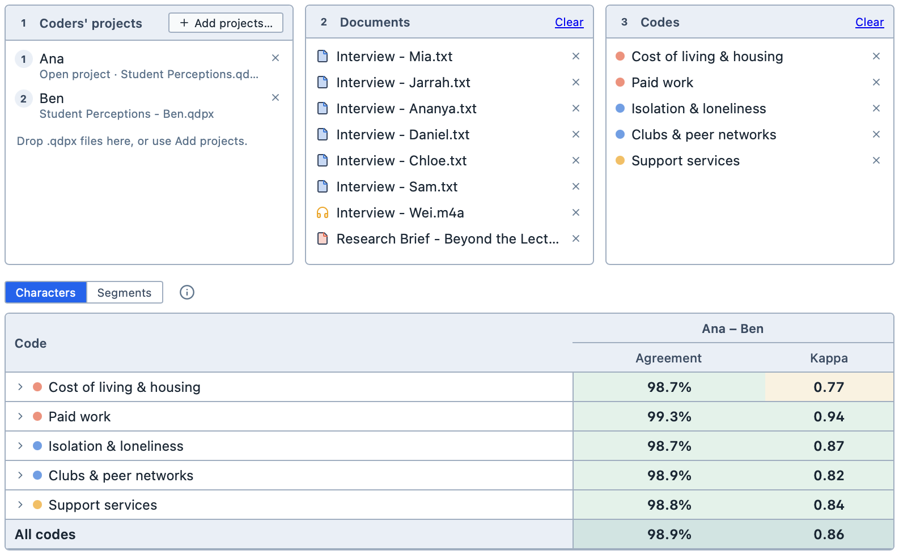
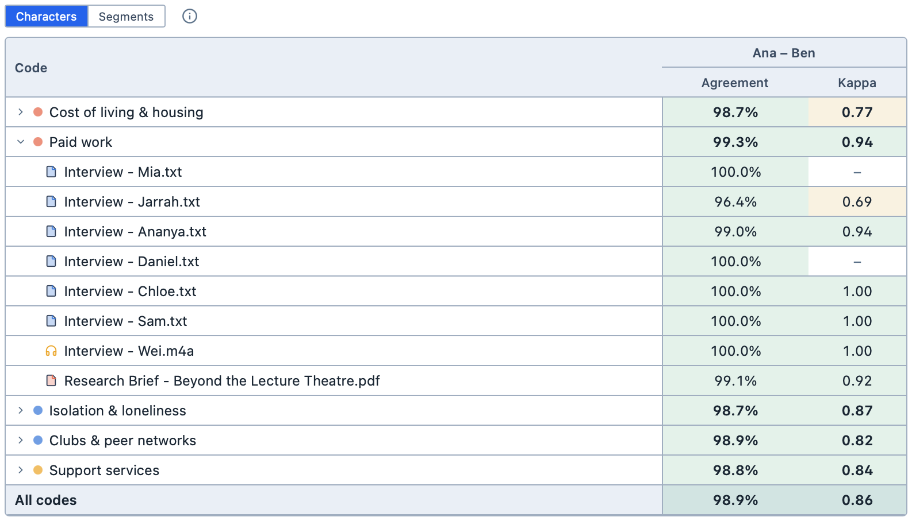
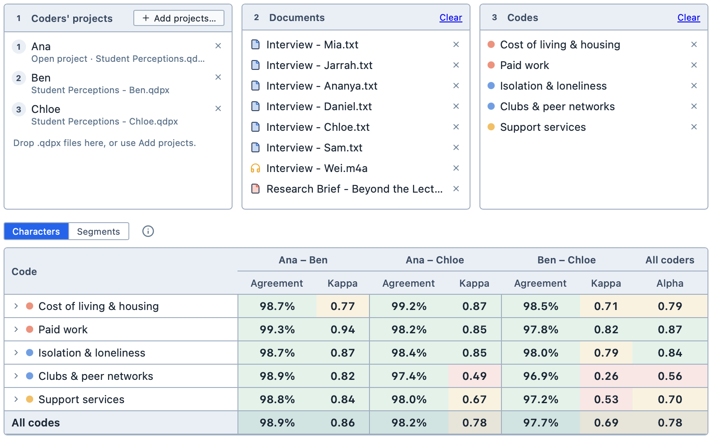
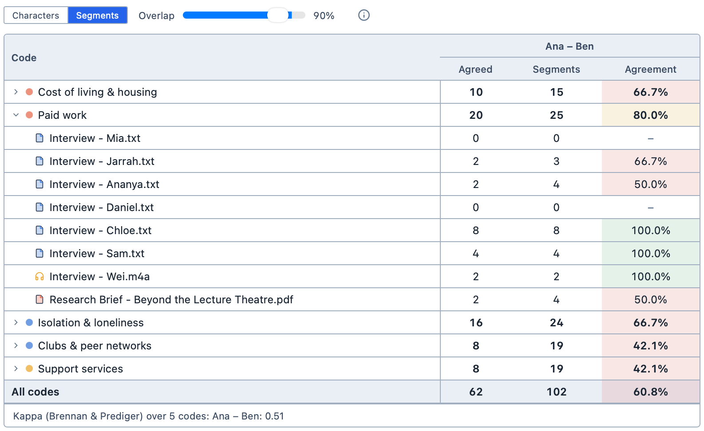

# Inter-coder Agreement

The Inter-coder Agreement tool allows you to compare how two or more people have coded the same documents. Each coder works in their own copy of the project, and Magnolia lines the copies up side by side: for each code, it shows how closely the coders agree, and lets you see exactly where they differ.

Think of it as laying two highlighted copies of the same interview on the table next to each other, but for every document and every code at once.

Checking agreement is a common step in team projects. It shows whether a codebook is clear enough for different people to apply it in the same way, and points you to the codes and passages worth discussing.

## Before you start

Each coder needs their own copy of the same project. The easiest way is to set up the project once (import the documents and create the codebook), then give each coder a copy of the `.qdpx` file to code on their own computer.

Magnolia matches the copies up for you:
- Documents are matched when they are the same document in each copy, or when they have the same name and type; and,
- Codes are matched when they are the same code in each copy, or when they have the same name in the same place in the code tree.

::: tip
Agree on the codebook before anyone starts coding. If a coder renames a code or moves it to another place in the tree, Magnolia treats it as a different code.
:::

Each coder is named after the person who last saved their file, as entered in `Preferences`. The project you have open is named after you.

**To open the Inter-coder Agreement tool:**

1. Click the `Analyse` tab in the ribbon.

2. Click `Inter-coder Agreement`, in the `Team` group.

## Setting up the comparison

The tool is set up in three boxes, from left to right.

<figure>
     
     <figcaption>The coders' projects, ready for documents and codes to be added.</figcaption>
</figure>

### 1. Coders' projects

The project you have open is already in the list.

**To add another coder's project:**

1. Click `Add projects…` and choose one or more `.qdpx` files; or,

2. Drag the `.qdpx` files from Finder or File Explorer into the box.

To remove a project, click the `x` beside it.

### 2. Documents

**To choose the documents to compare:**

1. Drag the documents from the Document Browser into the `Documents` box. You can also drag a folder to add every document in it, including those in its subfolders.

2. To remove a document, click the `x` beside it, or click `Clear` to remove them all.

Click a document to see which projects contain it. The projects that have it are highlighted in the first box. A document that is missing from some projects shows how many it is in (for example, `2/3`), and one that is only in a single project can't be compared.

::: info
If a document's text is not the same in every project (for example, because a coder edited it), Magnolia marks it with a warning sign. Its text codings can't be compared, because the same position no longer points to the same words. Its time ranges and box selections are still compared.
:::

### 3. Codes

**To choose the codes to compare:**

1. Drag the codes from the Code Browser into the `Codes` box.

2. To remove a code, click the `x` beside it, or click `Clear` to remove them all.

Each code is compared on its own. If you would like to include a code's subcodes, add them as codes of their own.

## Reading the results

The results appear beneath the three boxes as soon as there are two projects, a document and a code. You can compare the coders in two ways, by choosing `Characters` or `Segments`.

### Characters

<figure>
     
     <figcaption>Comparing two coders, character by character.</figcaption>
</figure>

`Characters` compares every part of every document: every character of text, every millisecond of audio and video, and every point of a PDF page or image. For each part, it checks whether each coder applied the code to it. For each pair of coders, the table shows:

| Column | What it shows |
| --- | --- |
| `Agreement` | The percentage of the documents that both coders coded the same way, whether they both applied the code or both left it out. |
| `Kappa` | Cohen's kappa: how much better the coders agree than they would by chance. 1 is perfect agreement, and 0 is no better than chance. |

::: tip
Agreement is usually very high, because the parts of a document that neither coder applied the code to count as agreement too. Kappa takes this into account, so it is the better figure for telling coders apart.
:::

The cells are shaded to help you spot weak agreement:

| Shade | Kappa | Agreement |
| --- | --- | --- |
| Green | 0.80 or more | 90% or more |
| Yellow | 0.60 to 0.79 | 80% to 89% |
| Red | Below 0.60 | Below 80% |

Click the `>` beside a code to see its results in each document.

<figure>
     
     <figcaption>The results for one code, document by document.</figcaption>
</figure>

A kappa of `–` means that neither coder applied the code in that document, so there is nothing to compare.

The `All codes` row brings every code together into a single figure for each pair of coders.

### Three or more coders

With three or more coders, the table has columns for every pair of coders, and an `All coders` column showing Krippendorff's alpha. Alpha measures the agreement between all the coders at once, and reads like kappa: 1 is perfect agreement, and 0 is no better than chance.

<figure>
     
     <figcaption>Comparing three coders.</figcaption>
</figure>

### Segments

`Segments` compares the coded segments themselves, rather than every character. A segment agrees when the other coder applied the same code to a segment that overlaps it closely enough. You can choose how closely with the `Overlap` slider: at 90%, the part the two segments share must be at least 90% of the span they cover together.

<figure>
     
     <figcaption>Comparing coded segments.</figcaption>
</figure>

| Column | What it shows |
| --- | --- |
| `Agreed` | The segments that the other coder matched. |
| `Segments` | All the segments from both coders. |
| `Agreement` | The agreed segments as a percentage of all the segments. |

Beneath the table is Brennan and Prediger's kappa, calculated over all the codes you have chosen.

## Seeing where coders differ

Click any result to see the passages behind it. The two coders' coding appears side by side, with each coder's coded text highlighted, so you can see exactly where they differ.

<figure>
     
     <figcaption>Where Ana and Ben coded Paid work differently.</figcaption>
</figure>

Only the passages where the coders differ are shown at first. Tick `Show agreements too` to see every passage. For audio and video, you see the transcript lines each coder coded, or their time ranges if the recording has no timed transcript. For PDFs and images, you see the outline of the box each coder drew, over the page or image itself on your own project's side.

Click the `x` to close the comparison.

## How the results are calculated

Click the `ⓘ` button beside `Characters` and `Segments` to see how each figure is calculated, with its formula.

<figure>
     
     <figcaption>Clicking the ⓘ button explains how the results are calculated.</figcaption>
</figure>

A few things are useful to know when you report your results:
- A code's row brings together all the documents, so a long document counts for more than a short one;
- `All codes` uses the pooled kappa of de Vries et al. (2008), which combines the codes' agreement before calculating kappa;
- Brennan and Prediger's kappa treats a segment that only one coder coded as a disagreement, so it may differ from the segment kappa in other programs; and,
- If one coder coded a recording on its transcript and another coded it on the timeline, Magnolia compares that code in that recording by time, using the times of the transcript lines. A coding of part of a line then counts for the whole line. Where every coder coded the transcript, it is compared character by character.

## Saving and exporting

You can save the analysis by clicking `Save Analysis`. It appears in the Saved Analyses Panel. If you make changes later, click `Update Analysis` to save them.

When you open a saved analysis again, Magnolia reads the coders' projects again, so the results include any coding they have done since. If a project has been moved or deleted, Magnolia shows the results as they were when you saved them.

::: info
If you add a project by dragging it into the box, Magnolia can't find it again after you restart Magnolia. To keep a saved analysis up to date, add the projects with `Add projects…` instead.
:::

You can export the table as a spreadsheet by clicking `Export CSV`.

You can also add the analysis to a [Report](/guide/reports) by dragging it from the Saved Analyses Panel into the report.
