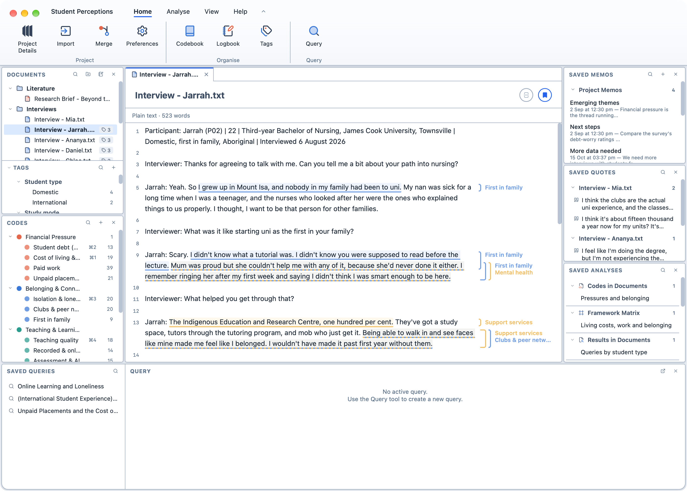
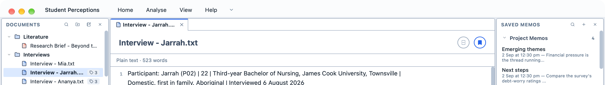

# Interface

Magnolia's window has two parts: the ribbon along the top, where you find Magnolia's commands, and the panes below it, where you work with your project.

<figure>
     
     <figcaption>Magnolia's window.</figcaption>
</figure>

## The ribbon

The ribbon groups Magnolia's commands on four tabs. Click a tab to see its buttons.

| Tab | What it contains |
| --- | --- |
| `Home` | `Project Details`, `Import`, `Merge` and `Preferences`; the `Codebook`, `Logbook`, `Memos` and `Tags`; and `Query`, which opens the [Query Builder](/guide/querying#the-query-builder). |
| `Analyse` | Every analysis tool, from [Codes in Documents](/guide/codesindocuments) to [Reports](/guide/reports). |
| `View` | A button for each pane, to show or hide it. |
| `Help` | The `Manual`, the `Licence`, and `Donate`. |

When a new version of Magnolia is available, a dot appears on `Preferences`.

On a smaller screen, or in a window less than 800 points tall, the ribbon is more compact: the group names under the buttons are hidden, and the buttons are smaller.

**To fold the ribbon away:**

1. Double-click any tab;
2. Click the arrow to the right of the tabs; or,
3. Choose `View` → `Show Ribbon` in the menu bar.

Only the tabs remain, which leaves more room for your work. While the ribbon is folded, click a tab to show its buttons; they disappear again when you click a button or anywhere else. Double-click a tab, click the arrow, or choose `View` → `Show Ribbon` again to bring the ribbon back.

<figure>
     
     <figcaption>The ribbon, folded away.</figcaption>
</figure>

::: tip
If you prefer a smaller toolbar, choose `Icons` under `Toolbar Style` in `Preferences` → `Appearance`. The same commands appear as a single row of icons, with the analysis tools, panes and help in pop-up menus.
:::

## The panes

| Pane | What it contains |
| --- | --- |
| Documents | Your documents, folders, surveys and [notebooks](/guide/notes), with the Tags pane beneath it. |
| Codes | Your codes. See [Coding your data](/guide/coding). |
| Viewer | The document, analysis or tool you are working on, each in its own tab. |
| Saved Queries and Query | Your saved queries, and the results of the current query. See [Querying your data](/guide/querying). |
| Saved Memos | Your [memos](/guide/whatisamemo). |
| Saved Quotes | Your [quotes](/guide/whatisaquote). |
| Saved Analyses | Your saved analyses and reports. |

**To show or hide a pane:**

1. Click the `View` tab in the ribbon.

2. Click the pane's button. A pane that is hidden has a faded button.

You can also close a pane with the `×` in its heading. The Query pane can be popped out into its own window with the button next to its `×`.

## Themes

Magnolia has three themes, which you choose in `Preferences` → `Appearance`:

| Theme | What it looks like |
| --- | --- |
| Magnolia | Light, with white panes on a pale blue-grey background. This is the default. |
| Magnolia Dark | The same layout in dark colours. Magnolia starts in this theme if your computer is set to dark mode. |
| High Contrast | Black and white with yellow highlights, and no colour in the icons. Magnolia starts in this theme if your computer is set to increase contrast. |
