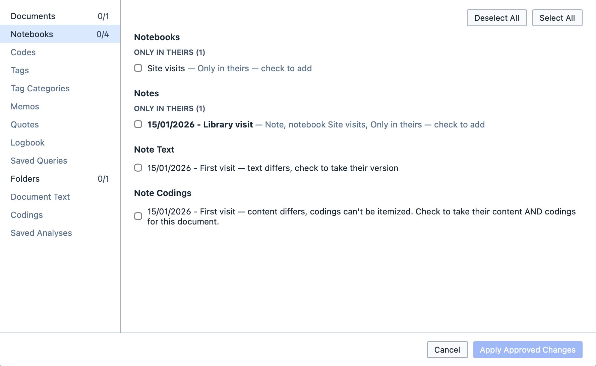

# Merging projects

The Merge tool allows you to combine two copies of a project, so that colleagues can work on their own copies and bring their work together. Think of it as comparing two versions of a document side by side, and choosing what to keep.

Magnolia compares the project you have open with the one you choose, and lists every difference. Nothing changes until you approve it.

**To merge a project:**

1. Open your copy of the project;
2. Click `Merge` on the `Home` tab of the ribbon;
3. Choose the other copy of the project;
4. Go through each section on the left, and tick the changes you want to keep; and,
5. Click `Apply Approved Changes`, then `Save`.

A tick always means "this will be in the merged project". Something only in the other copy is unticked, so tick it to add it; something only in yours is ticked, so untick it to remove it. `Select All` and `Deselect All` apply to the section you are looking at.

## Sections

| Section | What it compares |
| --- | --- |
| `Documents` | Documents added or removed, renamed, or moved to another folder. |
| `Notebooks` | Notebooks, the notes in them, the notes' text, and their codings. |
| `Codes`, `Tags`, `Tag Categories` | Your codes and tags, and their names, colours and options. |
| `Memos`, `Quotes`, `Logbook` | Memos, quotes and logbook entries. |
| `Saved Queries`, `Saved Analyses` | Saved queries and analyses. |
| `Folders` | Folders added, removed or renamed. |
| `Document Text` | Documents whose text differs. |
| `Codings` | Coded segments added or removed. |

<figure>
     
     <figcaption>The Notebooks section, with a new notebook and note, and a note whose text has changed.</figcaption>
</figure>

## Where documents and notes go
A document or note you take from the other copy goes where it is filed there: in the same folder or notebook. If your project doesn't have that folder or notebook, Magnolia uses one of the same name, or brings it across.

::: tip
A note always stays in a notebook. If you remove a notebook in a merge but keep some of its notes, Magnolia keeps the notebook too.
:::
