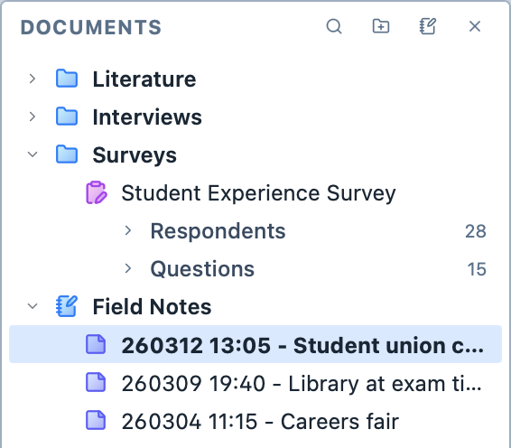
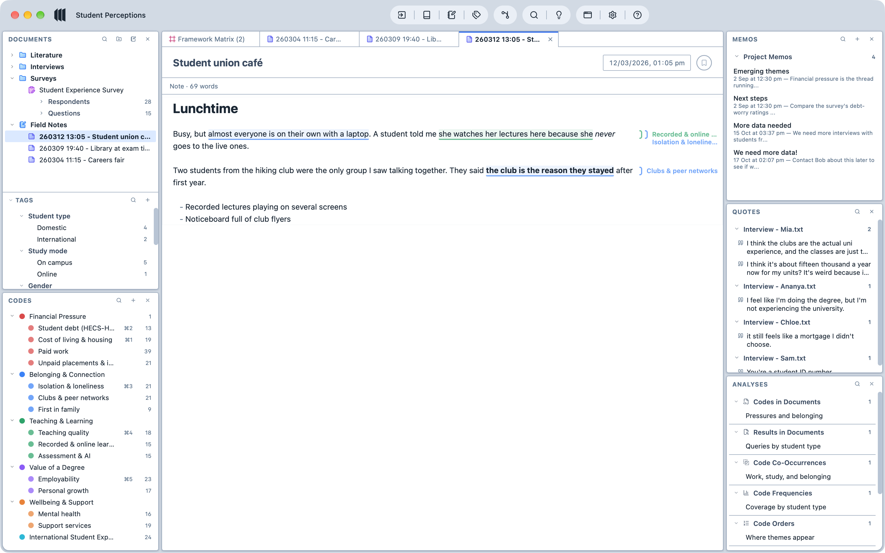

# Notes

The Notes feature allows you to write your own notes inside Magnolia, such as field notes, observations, or reflections, and to code them just as you would any other document. Think of it as a field notebook that sits alongside the rest of your data.

Notes are kept in *notebooks*. Each note has a title and the date and time of the observation, and is named after them in the form `YYMMDD HH:MM - Title` (for example, `261104 14:30 - Library foyer`). Within a notebook, notes are always listed newest first.

<figure>
  
  <figcaption>A notebook in the Document Browser.</figcaption>
</figure>

::: info
A note is not the same as a [memo](/guide/whatisamemo). A memo is attached to something else in your project, such as a document, a selection or an analysis. A note is a piece of data in its own right: it can be coded, queried and analysed.
:::

## Creating notebooks

**To create a notebook:**

1. Click the notebook button at the top of the Document Browser; or,
2. Right-click a folder and choose `New Notebook` to create the notebook inside that folder.

3. Enter a name for the notebook and click `Okay`.

Notebooks can sit inside folders, but notes can only sit inside notebooks.

## Creating notes

**To create a note:**

1. Hover over the notebook in the Document Browser and click the `+` button; or,
2. Right-click the notebook and choose `New Note`.

3. The new note opens in the Viewer, dated with the current date and time.

4. Type a title and press `Enter` to start writing the note.

## Writing notes

Notes are written directly in the Viewer. There is no separate editing mode: you write and code in the same place.

Notes are written in Markdown. The Markdown syntax is only shown on the line you are typing on; everywhere else, you see the formatted text.

<figure>
  
  <figcaption>A note being written and coded in the Viewer.</figcaption>
</figure>

| To get | Type | Shortcut |
| --- | --- | --- |
| **Bold** | `**bold**` | `⌘ + B` |
| *Italic* | `*italic*` | `⌘ + I` |
| A heading | `# Heading` | |
| A bulleted list | `- ` at the start of a line | |
| A numbered list | `1. ` at the start of a line | |
| A checklist | `- [ ] ` at the start of a line | |

Pressing `Enter` at the end of a list item starts the next item. Pressing `Enter` on an empty item ends the list. Press `⇧ + Enter` for a new line without a new list item.

::: tip
Undo (`⌘ + Z`) works for typing in a note, just as it does for everything else in your project.
:::

## Changing a note's title or date

The title and the date and time of the observation are shown at the top of the Viewer. You can change either at any time, and the note's name and its place in the notebook follow.

**To change a note's title:**

1. Click the title at the top of the Viewer and type a new one; or,
2. Right-click the note in the Document Browser and rename it.

**To change a note's date and time:**

1. Click the date and time at the top of the Viewer and change them.

## Coding notes

Notes are coded in exactly the same way as any other text. See [Coding text](/guide/coding#coding-text).

You can keep writing after you have coded a note. Codes, quotes and memos stay attached to the same words as you type around them.

## Moving and deleting notes

**To move a note to another notebook:**

1. Drag the note onto another notebook; or,
2. Right-click the note and choose `Move to Notebook`.

**To delete a note:**

1. Right-click the note in the Document Browser.

2. Choose `Delete Note`.

**To delete a notebook:**

1. Right-click the notebook in the Document Browser.

2. Choose `Delete Notebook`.

::: warning
Deleting a notebook deletes all of the notes inside it, along with their codes, quotes and memos. Magnolia asks you to confirm first.
:::

## Notes in queries and analyses

Notes can be queried and analysed like any other document.

- To target your notes in the [Document Selector](/guide/documentselector), use the `Notes` document type, or choose the notebook as a `Folder`.
- In tools with `Grouped by`, each notebook is shown as a single column, in the same way as a survey. Remove the notebook from `Grouped by` to see a column for each of its notes. See [Grouping Results](/guide/grouping).

::: info
Notes are saved in your project as ordinary text documents. If you open your project in other QDA software, your notes appear as text documents named `YYMMDD HH:MM - Title`.
:::
