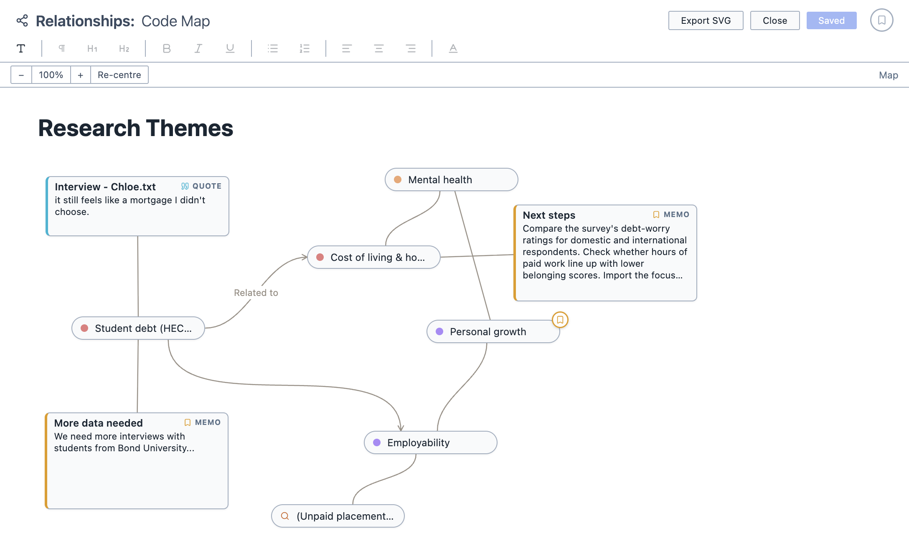

# Relationships

The Relationships tool allows you to map the relationships between different things in your project. You place items on a canvas, draw connections between them, and add your own notes.

Unlike most other QDA software, Magnolia allows you to map relationships between everything. You are not limited to just codes! You can drag documents, codes, memos, queries, analyses, and more onto the canvas. Everything is interactive: double clicking on something then takes you to that thing.

Think of it as a pinboard, where you can pin up documents, codes and quotes, and run string between them to show how they are connected.

<figure>
     
     <figcaption>A relationship map with codes, a quote, memos, a saved query and a heading.</figcaption>
</figure>

**To open Relationships:**

1. Click the `Analyse` button in the toolbar.

2. Choose `Relationships`.

## Adding items

**To add an item to the map:**

1. Drag it onto the canvas from:
   1. The Document Browser (documents, tags, folders, and survey respondents and questions);
   2. The Code Browser (codes);
   3. The Saved Queries Panel (saved queries);
   4. The Analyses Panel (saved analyses);
   5. The Memos Panel or the Quotes Panel (memos and quotes); or,
   6. The Query Results pane (individual query results).

2. The item appears on the canvas as a box. To move it, drag it by its header.

To add a memo straight onto the map, right-click on the canvas and choose `Add Memo`. Right-clicking on an item and choosing `Add Memo` attaches the memo to that item.

## Adding text

**To add text to the map:**

1. Click the `Add Text` button in the toolbar.

2. Click on the canvas where you would like the text to go.

3. Type your text. You can format it using the toolbar: headings, bold, italics, underline, lists, alignment and colour.

## Connecting items

**To connect two items:**

1. Click and drag from the body of an item (or the connector on the right of a text box) to another item.

2. Let go, and a line connects the two.

Click the end of a line to add or remove an arrowhead.

To give a line a label, such as "causes" or "contradicts", hover over it and click the `+` that appears in the middle. Click an existing label to change it.

## Working with the map

Everything on the map stays connected to your project. Double-click an item to go to it:

| Item | Double-clicking it |
| --- | --- |
| Document | Opens the document |
| Code | Shows every selection coded with the code |
| Saved query | Runs the query |
| Quote or query result | Opens the document at that passage |
| Memo | Opens the memo |
| Tag or folder | Selects its documents in the Document Browser |
| Saved analysis | Opens the analysis |

## Saving and exporting

You can save the map by clicking `Save Analysis`. It appears in the Analyses Panel. If you make changes later, click `Update Analysis` to save them.

You can export the map as an image by clicking the export button in the toolbar. The map is saved as an `.svg` file.

You can also add the map to a [Report](/guide/reports) by dragging it from the Analyses Panel into the report.
