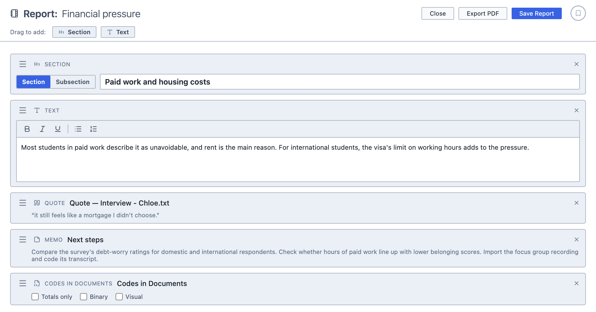
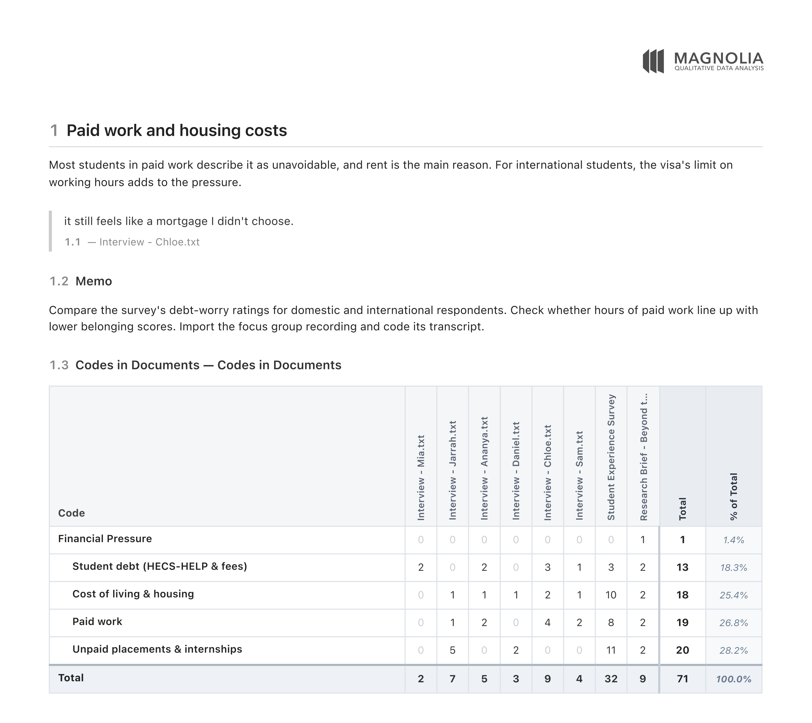

# Reports

The Reports tool allows you to compile your work into a single document and export it as a PDF. You can bring together documents, query results, quotes, memos, survey data and analyses, and arrange them under your own headings and text.

Think of it as the place where your project comes together. Rather than copying and pasting results into a word processor, you drag them into a report, and Magnolia lays them out for you.

**To open Reports:**

1. Click the `Analyse` button in the toolbar.

2. Choose `Reports`.

3. Give your report a title by typing it next to `Report:`.

## Adding content

**To add content to a report:**

1. Drag it into the report from:
   1. The Document Browser (documents, and survey questions, respondents and answers);
   2. The Saved Queries Panel (saved queries);
   3. The Analyses Panel (saved analyses);
   4. The Memos Panel (memos); or,
   5. The Quotes Panel (quotes).

2. The item appears in the report. You can drop it between existing items to place it exactly where you want it.

**To add your own headings and text:**

1. Drag `Section` or `Text` from the bar at the top of the report into the report.

2. Type your heading or text into the box.

Sections can be either a `Section` or a `Subsection`. They are numbered automatically, and they make up the report's table of contents.

<figure>
     
     <figcaption>A report with a section, some text, a quote, a memo and an analysis.</figcaption>
</figure>

## Arranging the report

To move an item, drag it by its `≡` handle. To remove an item, click the `×` beside it.

## Analysis options

Some analyses have options that change how they appear in the report:

| Option | Output |
| --- | --- |
| `Totals only` | Hides the columns for individual documents, leaving only the subtotals and totals |
| `Binary` | Shows `1` or `0` in each cell, as in the analysis's own Binary view |
| `Visual` | Shows each cell as a coloured square, as in the analysis's own Visual view |
| `Bar chart` | Adds the bar chart (Word Frequencies only) |
| `Word cloud` | Adds the word cloud (Word Frequencies only) |

::: info
Analyses in a report are always worked out afresh when you export. If you have coded more since you added an analysis to your report, the exported report includes your latest coding.
:::

## Saving and exporting

You can save the report by clicking `Save Report`. It appears in the Analyses Panel. Once a report has been saved, your changes are saved automatically as you work.

To export the report, click `Export PDF`. The PDF begins with a table of contents, and each item in the report follows in order.

<figure>
     
     <figcaption>A page from the exported PDF.</figcaption>
</figure>
