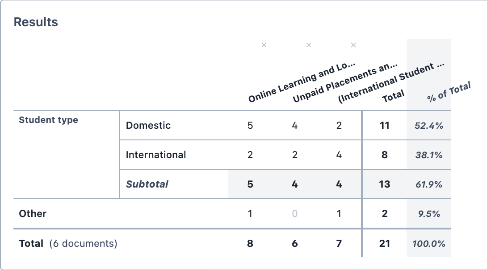
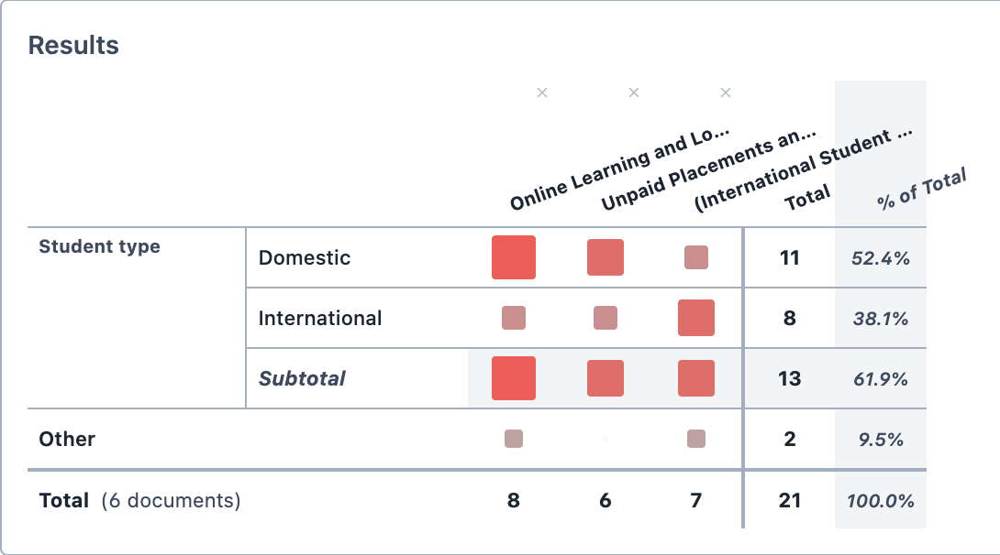
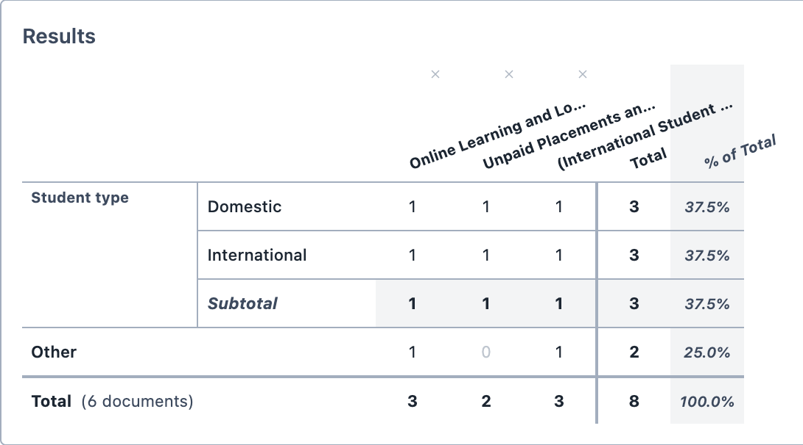
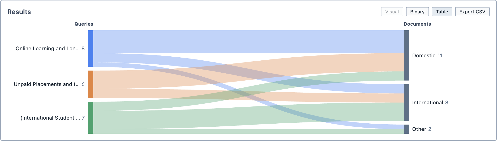

# Results in Documents

The Results in Documents tool allows you to see how many results your saved queries find in each document. Saved queries make up the columns of the table, and documents make up the rows.

Think of it as Codes in Documents for queries: instead of asking "where does this code appear?", it asks "where does this query find something?".

**To open Results in Documents:**

1. Click the `Analyse` button in the toolbar.

2. Choose `Results in Documents`.

The tool contains the [Group By](/guide/grouping) function.

## Adding queries

**To add queries to the table:**

1. Drag the saved queries from the Saved Queries Panel into the `Results` box.

2. Each query appears as a column in the table.

3. To remove a query, click the `×` above its name.

The rows are the documents where at least one of your queries finds a result. Each query searches the documents set in its own [Document Selector](/guide/documentselector), so to change which documents a query searches, edit the query itself.

::: tip
Only saved queries can be added. You can save a query by clicking `Save Query` in the Query Results pane.
:::

## Reading the results

Each cell shows how many results that query finds in that document (or group of documents). The `Total` column and row add up the table, and the `% of Total` column shows each row's total as a percentage of the grand total. The `Total` row also shows how many documents the table covers.

<figure>
     
     <figcaption>The results table, with three saved queries and the documents grouped by the Student type tag category.</figcaption>
</figure>

You can change how the results are displayed using the buttons above the table:

| Button | Output |
| --- | --- |
| `Visual` | Shows each cell as a coloured square, sized and shaded by its count. Click `Numeric` to return to numbers. |
| `Binary` | Shows `1` if the query finds anything in that document and `0` if it does not. Click `Counts` to return to counts. |
| `Sankey` | Shows the table as a Sankey diagram, with query results flowing into documents. Click `Table` to return to the table. |

<figure>
     
     <figcaption>The Visual view.</figcaption>
</figure>

<figure>
     
     <figcaption>The Binary view.</figcaption>
</figure>

<figure>
     
     <figcaption>The Sankey view.</figcaption>
</figure>

## Exploring the results

Click any cell with a count above zero to run that query in that document. The results appear in the Query Results pane.

- Clicking the `Total` at the bottom of a query's column runs that query across every document in the table.
- Clicking the `Total` at the end of a document's row runs all of the queries together in that document.

## Saving and exporting

You can save the analysis by clicking `Save Analysis`. It appears in the Analyses Panel. If you make changes later, click `Update Analysis` to save them.

You can export the table as a spreadsheet by clicking `Export CSV`.

You can also add the analysis to a [Report](/guide/reports) by dragging it from the Analyses Panel into the report.
