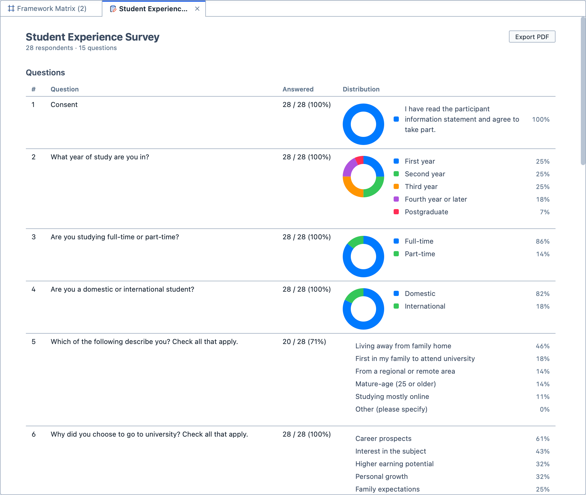
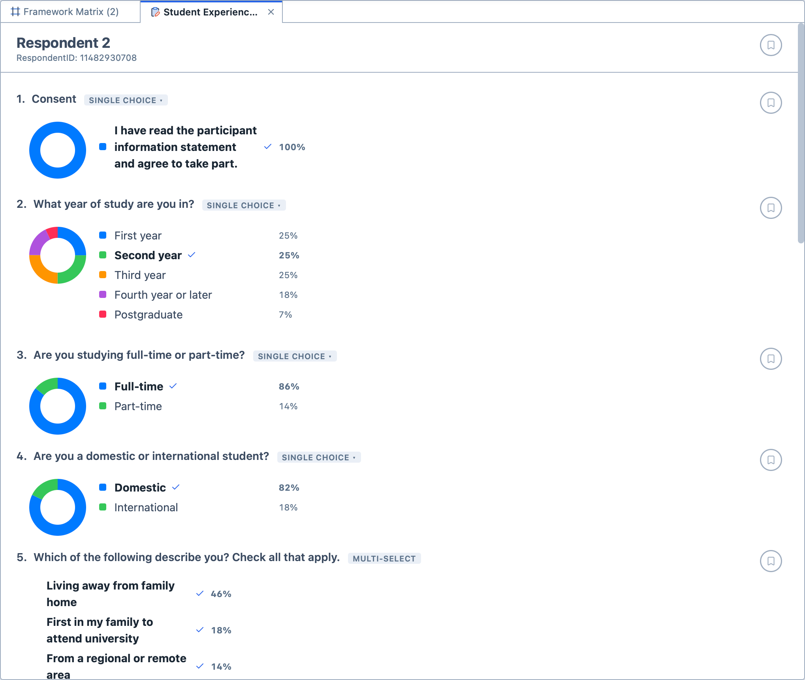
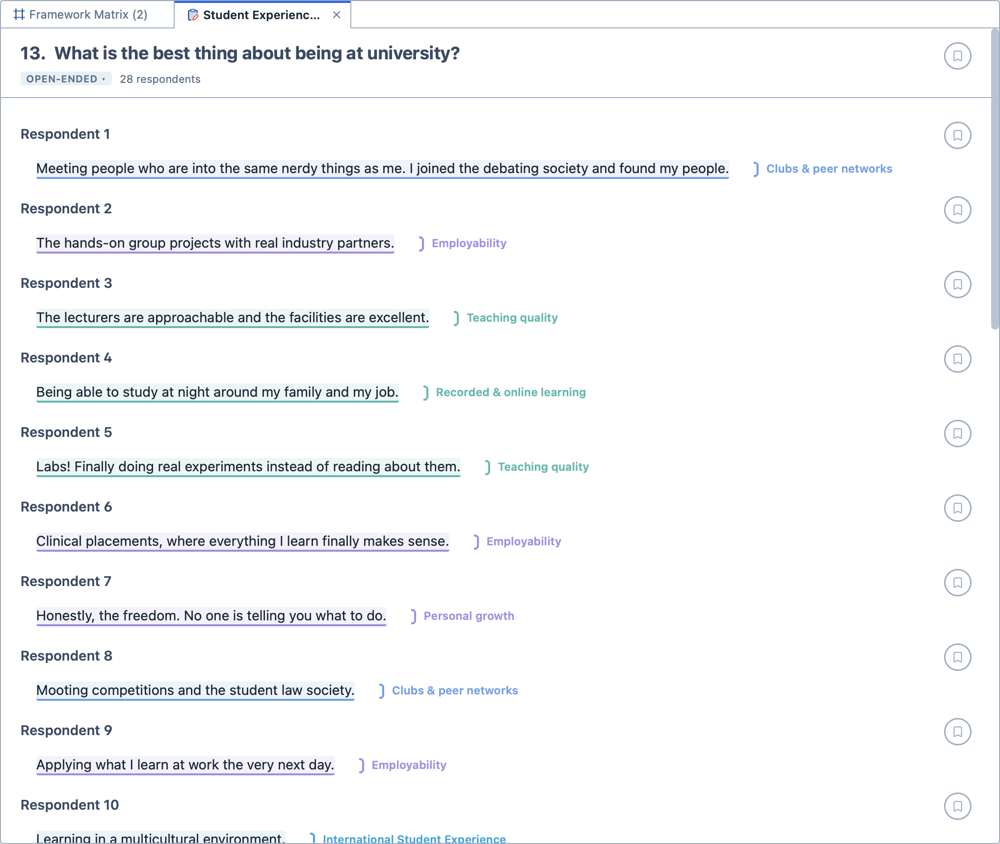

# Surveys

The Surveys feature allows you to bring survey data into Magnolia, code the answers to open-ended questions, and see at a glance how closed questions were answered. A survey stays together as one document in your project: it isn't broken up into a document for each respondent.

## Importing a survey

Magnolia reads surveys saved as `.csv` or `.xlsx` files. It recognises exports from SurveyMonkey and Microsoft Forms, and reads any other spreadsheet with one row for each respondent and one column for each question.

**To import a survey:**

1. Import the file as you would any other document. See [Importing documents](/guide/importing).

2. Magnolia shows a preview of the survey before it is added. Check the survey's name, and check the type Magnolia has given each column:

   | Type | Use |
   | --- | --- |
   | `Open-ended` | Free-text answers, which you can code. |
   | `Single choice` | Questions where each respondent picked one option. |
   | `Multi-select` | Questions where each respondent could pick several options. |
   | `Numeric` | Answers that are numbers, such as ratings or ages. |
   | `Metadata` | Information about the respondent rather than an answer, such as their ID or the date they responded. |
   | `Skip` | Columns you don't want to import. |

3. If Magnolia has guessed a type wrongly, choose the right one from the menu beside the column.

4. Click `Import`. The button shows how many respondents will be imported, for example `Import 28 Respondents`.

The survey appears in the Documents Panel. Under it are its `Respondents` and its `Questions`.

## Reading a survey

A survey can be read in three ways:
- The summary, which opens when you open the survey. It lists every question, with how many respondents answered it and how its answers were spread, and then every respondent, with how many questions they answered;
- A respondent's answers. Click a respondent under `Respondents` in the Documents Panel to read all of their answers, one question after another; and,
- A question's answers. Click a question under `Questions` in the Documents Panel to read every respondent's answer to it.

In the summary, click a question or a respondent to go to their answers.

<figure>
     
     <figcaption>A survey's summary.</figcaption>
</figure>

For closed questions, Magnolia draws the spread of the answers: the share of respondents who chose each option, or a box plot for numeric answers. When you read a respondent's answers, their own answer is ticked on each chart, so you can see where they sit among the other respondents.

<figure>
     
     <figcaption>One respondent's answers. Their own answers are ticked.</figcaption>
</figure>

<figure>
     
     <figcaption>Every respondent's answer to an open-ended question, coded.</figcaption>
</figure>

Each question shows its type beside it. If a question has the wrong type, click its type and choose another. A question with one column can be open-ended, single choice or numeric; a multi-select question stays multi-select.

## Coding answers

You code a respondent's answers just as you would any other text. See [Coding your data](/guide/coding).

**To code an answer:**

1. Open the respondent's or the question's answers.

2. Select the text you wish to code. A selection can run across several answers.

3. Drag a code from the Code Browser onto the selection; or,
4. Drag the grab handle on the end of the selection onto a code in the Code Browser; or,
5. Press the code's hotkey; or,
6. Right-click the selection and choose a code under `Apply Code`.

When a selection runs across several answers, each answer is coded separately, so that every coded passage still belongs to one respondent.

You can also attach memos and quotes to answers. A memo can be attached to a whole survey, a respondent, a question, or one respondent's answer to one question. See [What is a memo?](/guide/whatisamemo).

## Tagging respondents and questions

You can tag respondents and questions just as you tag documents. Drag a tag onto a respondent or a question in the Documents Panel.

Tags let you group respondents in the analysis tools. For example, you might tag each respondent as a domestic or an international student, then compare how the two groups answered. See [Grouping](/guide/grouping).

## Exporting a summary

Click `Export PDF` in the survey's summary to save it as a PDF. The PDF includes the spread of answers to every closed question, and every respondent's answers to the open-ended questions.
