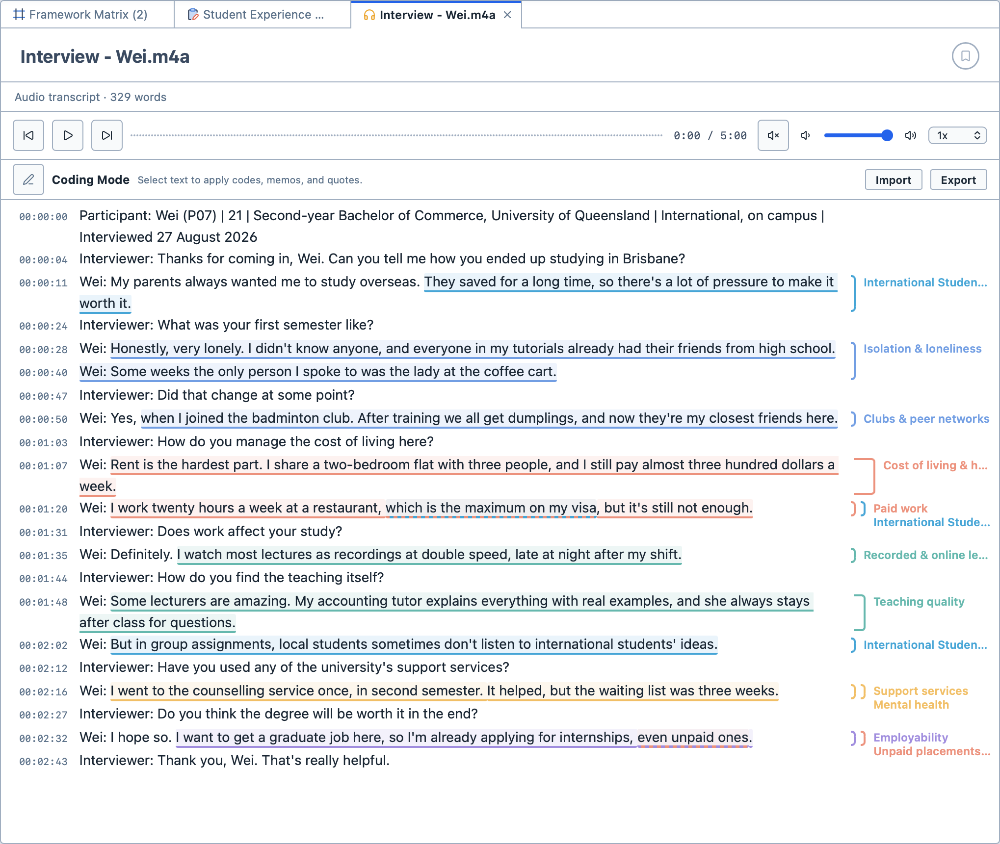

# Transcription

The Transcription feature allows you to transcribe audio and video recordings inside Magnolia, and then code the transcript. Each line of the transcript remembers the moment in the recording it belongs to, so you can jump straight back to any line in the recording.

When you open an audio or a video file, the player sits at the top and the transcript below it. The transcript is in one of two modes, shown above it:
- `Transcribing Mode`, in which you type the transcript. Coding is switched off while you type; and,
- `Coding Mode`, in which you select the transcript's text to code it, and attach memos and quotes, as in any other document.

Click the pen button beside the mode's name to switch between them.

## Transcribing a recording

**To transcribe a recording:**

1. Import the audio or video file. See [Importing documents](/guide/importing).

2. Open it, and switch to `Transcribing Mode`.

3. Play the recording, and type what you hear.

4. Press `Enter` to start a new line. Each new line is stamped with the time the recording has reached, so you don't need to type timestamps yourself.

The player's buttons let you play and pause, rewind and fast-forward (hold the button down to keep going), change the volume, and slow the recording down or speed it up, from `0.5x` to `2x`.

::: tip
Slowing the recording down to `0.75x` makes it much easier to keep up while you type.
:::

## Controlling playback from the keyboard or a foot pedal

You can play, pause, rewind and fast-forward without leaving the keyboard. By default:

| Key | Action |
| --- | --- |
| `F5` | Play or pause. |
| `F6` | Rewind 5 seconds. |
| `F7` | Fast-forward 5 seconds. |

Many transcription foot pedals work by pressing a key. If you have one, set its buttons to send these keys, and you can control playback with your feet while you type.

**To change the keys:**

1. Open `Preferences`.

2. Choose `Media Playback`.

3. Choose a key for each action, and how many seconds rewind and fast-forward jump. You can also choose the speed recordings start playing at.

## Importing a transcript

If you already have a transcript, for example from a transcription service, you can bring it in instead of typing it.

**To import a transcript:**

1. Open the audio or video file.

2. Click `Import` above the transcript.

3. Choose the transcript file. Magnolia reads `.txt`, `.md`, `.srt`, `.vtt` and `.html` files. Timestamps in the transcript are matched to the recording.

If the transcript names its speakers (for example "Interviewer:" and "Jarrah:"), Magnolia offers to code each speaker's lines for you. For each speaker, drag a code from the Code Browser onto the speaker, or click `Create` to make a new code. Click the play button beside a speaker to hear a short sample of them. Then click the `Code` button, which shows how many speakers you have given a code (for example `Code 2 speakers`), or click `Skip` to leave the transcript uncoded.

## Coding a transcript

In `Coding Mode`, you code a transcript just as you would any other text. See [Coding your data](/guide/coding). The time of each line is shown beside it. Click a time to jump to that moment in the recording.

<figure>
     
     <figcaption>A coded interview transcript, with the time of each line beside it.</figcaption>
</figure>

In a video, the codes you apply to the transcript are applied to the same stretch of the video: the video and its transcript share one set of codes. They also appear on the track between the video and the transcript, so you can see where each code falls in the recording. Drag either end of a code on the track to change the stretch of the video it covers.

While a video is paused, press the left and right arrow keys to step back and forward a frame at a time.

## Exporting a transcript

Click `Export` above the transcript, then choose `Export as TXT`, `Export as Markdown` or `Export as PDF`.
