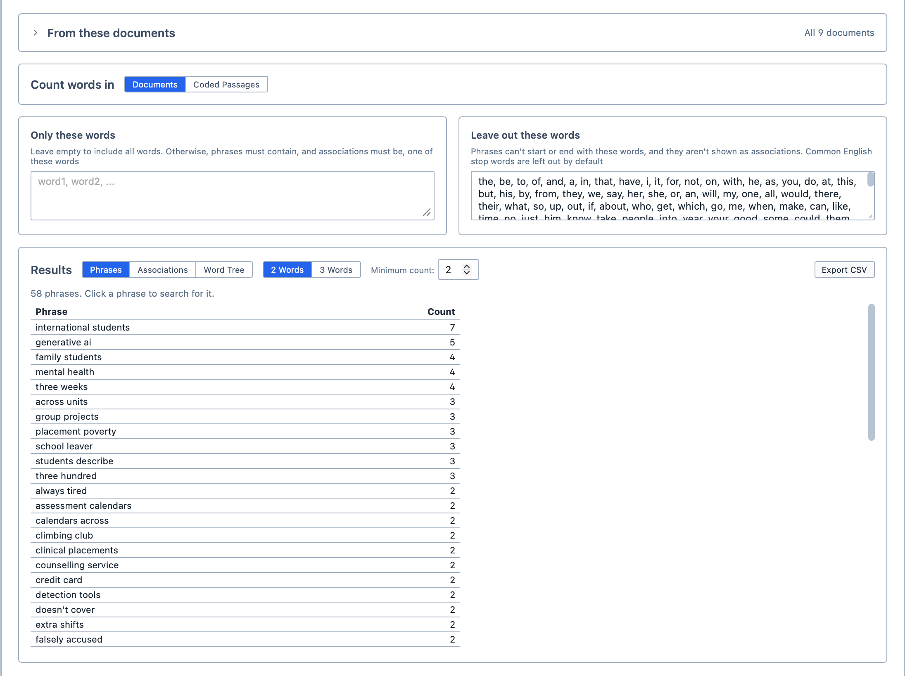
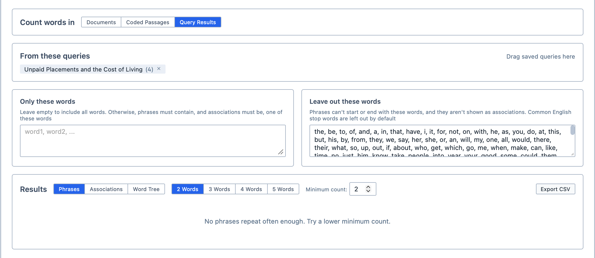
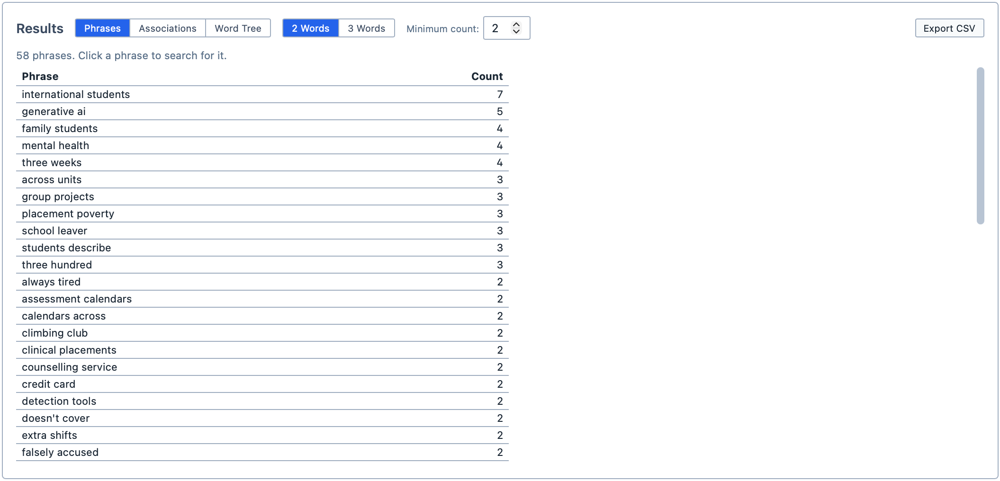
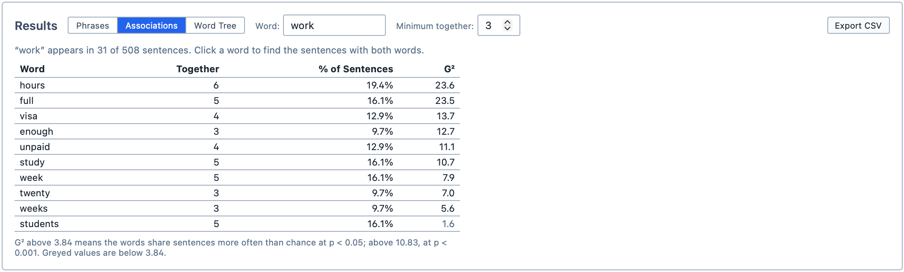
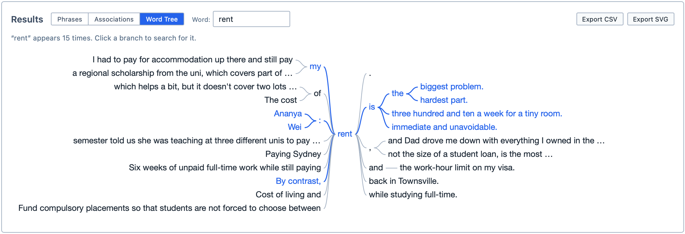

# Word Combinations

The Word Combinations tool allows you to see which words go together in your documents. Where [Word Frequencies](/guide/wordfrequencies) tells you which words are common, Word Combinations tells you how they are used: the phrases that keep coming up, the words that appear alongside a word you choose, and every context a word appears in.

**To open Word Combinations:**

1. Click the `Analyse` tab in the ribbon.

2. Click `Word Combinations`.

The tool contains:
- The `Count words in` choice, as in [Word Frequencies](/guide/wordfrequencies#choosing-what-to-count)
- The [Document Selector](/guide/documentselector) (when reading documents or coded passages)

The tool shows its results in three ways, which you choose with the buttons above the results:

| Button | Output |
| --- | --- |
| `Phrases` | Lists the sequences of two to five words that repeat, or draws them as a network. This is the default. |
| `Associations` | Lists the words that appear in the same sentences as a word you choose. |
| `Word Tree` | Shows every place a word you choose appears, with the words before and after it. |

<figure>
     
     <figcaption>The Word Combinations tool, showing phrases.</figcaption>
</figure>

## Choosing what to read

Use `Count words in` to choose what Magnolia reads:
- `Documents` reads the whole of each selected document;
- `Coded Passages` reads only the passages you have coded with particular codes. Drag the codes from the Code Browser into the `Coded with` box; or,
- `Query Results` reads only the results of your saved [queries](/guide/querying). Drag the queries from the Saved Queries Panel into the `From these queries` box.

When you read coded passages, the passages of all your codes are read together. When you read query results, the results of all your queries are read together. Either way, clicking a result searches only inside the passages or results being read.

Each query searches the documents you chose when you built it, so the Document Selector is hidden while you read query results.

<figure>
     
     <figcaption>Reading the results of a saved query.</figcaption>
</figure>

## Phrases

`Phrases` lists the sequences of words that appear more than once, with the number of times each one appears. Think of it as finding the expressions your participants keep reaching for, such as "cost of living" or "mental health".

| Option | Use |
| --- | --- |
| `Phrase length` | Chooses how many words each phrase has, from `2` to `5`. Longer phrases repeat less often, so you may need to lower `Appears at least` to see any. |
| `List` or `Network` | Chooses whether the phrases are listed or drawn as a network (see [The phrase network](#the-phrase-network)). |
| `Appears at least` | Shows only the phrases that appear at least this many times. It starts at 2. |

A phrase never runs across punctuation or a line break, so "money, time" is not counted as a phrase.

You can change which phrases are listed using the two boxes above the results:

| Box | Use |
| --- | --- |
| `Only these words` | Lists only the phrases that contain one of these words. Leave it empty to list every phrase. |
| `Leave out these words` | Leaves out the phrases that start or end with one of these words. It starts with the list of common English words (such as "the" and "of"), which you can edit. |

Because only the start and end of a phrase are checked, phrases such as "quality of life" are kept even though "of" is left out, while phrases such as "of the" are not.

<figure>
     
     <figcaption>The phrases of two words that appear at least twice.</figcaption>
</figure>

Click a phrase to search for it. Every place it appears is shown in the Query Results pane.

### The phrase network

Click `Network` to draw the phrases instead of listing them. Each word is a dot, and the words that follow each other in a phrase are joined by a line. The more often a phrase appears, the thicker its line; the more often a word appears in phrases, the bigger its dot. Words that appear in several phrases join them up, so you can see, for example, that "mental health" and "health services" share "health".

With a phrase length of `2` the network shows pairs of words; with `3` and more, each phrase is drawn as a chain of lines.

Words in `Leave out these words` aren't drawn. Instead, the line runs between the words either side of them: "quality of life" is drawn as a line from "quality" to "life". This stops small words such as "of" from joining up phrases that have nothing to do with each other.

Only the 80 most common phrases are drawn, so the network stays readable. Raise `Appears at least` or add words to `Only these words` to focus it further.

**In the network:**
- Hover over a word to see the words it is joined to;
- Hover over a line to see the phrases it stands for;
- Click a line to search for its phrase. If the line stands for more than one phrase, the most common one is searched; or,
- Click a word to see it in the [Word Tree](#word-tree).

## Associations

`Associations` takes a word you choose and lists the words that appear in the same sentences as it more often than chance would explain. For example, if "rent" keeps appearing in the same sentences as "worry", "worry" is near the top of the list for "rent".

**To see a word's associations:**

1. Click `Associations`.

2. Type a word into the `Word` box. If you leave it empty, Magnolia uses the most frequent word that isn't in `Leave out these words`.

The table lists each associated word with:

| Column | Shows |
| --- | --- |
| `Together` | How many sentences contain both words. |
| `% of Sentences` | The share of the chosen word's sentences that also contain this word. |
| `G²` | How unlikely it is that the two words share this many sentences by chance. The higher the number, the stronger the association. |

Use `Minimum together` to hide words that share fewer sentences than this with the chosen word. It starts at 3.

::: info
G² (log-likelihood) is a common measure of how strongly two words are associated. As a rule of thumb, a G² above 3.84 means the words appear together more often than chance would explain (at p < 0.05), and above 10.83, much more often (at p < 0.001). Values below 3.84 are shown in grey.
:::

A sentence ends at a full stop, a question mark or an exclamation mark, or at a line break.

<figure>
     
     <figcaption>The words associated with “work”.</figcaption>
</figure>

Click a word in the table to find the sentences where it appears with the chosen word. They are shown in the Query Results pane.

## Word Tree

`Word Tree` shows every place a word you choose appears. The words that come after it branch out to the right, and the words that come before it branch out to the left. When several sentences go on in the same way, they share a branch, so the tree reads as the phrases your participants use. Think of it as reading every sentence containing the word at once.

**To see a word tree:**

1. Click `Word Tree`.

2. Type a word into the `Word` box. If you leave it empty, Magnolia uses the most frequent word that isn't a common English word. The word is shared with `Associations`, so you can switch between the two.

Hover over a branch to highlight the sentences that run through it, on both sides of the word. Click a branch to search for it: the text from the word to the end of the branch is shown in the Query Results pane.

A branch reaches up to 12 words from the chosen word. If a sentence goes on further, the branch ends with `…`.

The word tree shows every word, so the `Only these words` and `Leave out these words` boxes are hidden while it is showing.

<figure>
     
     <figcaption>The word tree for “rent”, with the sentences through “is” highlighted.</figcaption>
</figure>

::: tip
A very common word, such as "the", can produce a tree with hundreds of branches. The tree scrolls, but you will usually learn more from a less common word.
:::

## Saving and exporting

You can save the analysis by clicking `Save Analysis`. It appears in the Saved Analyses Panel. If you make changes later, click `Update Analysis` to save them.

You can export the current results as a spreadsheet by clicking `Export CSV`. In `Word Tree`, and in the phrase network, you can also export the picture by clicking `Export SVG`.

You can also add the analysis to a [Report](/guide/reports) by dragging it from the Saved Analyses Panel into the report. The report shows the results in the way they were showing when you saved the analysis.
