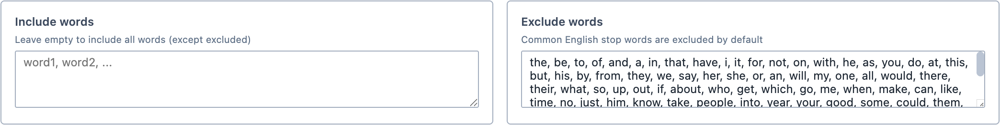
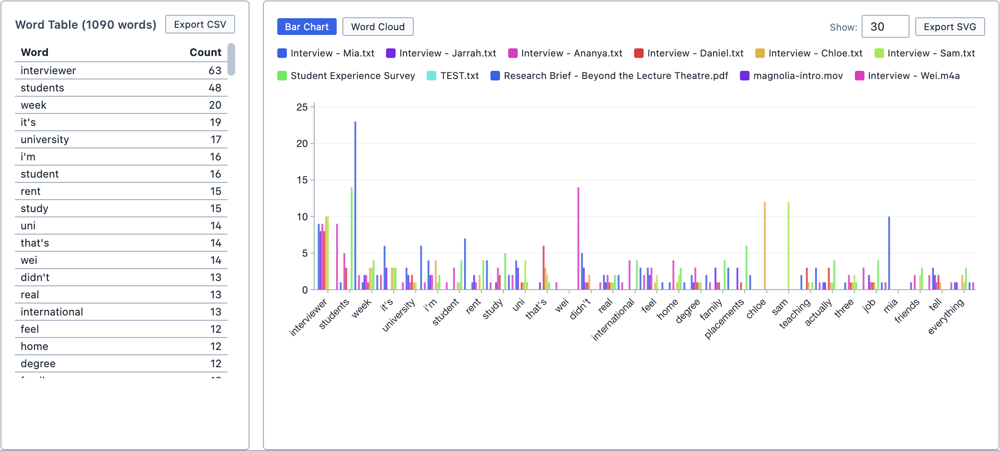
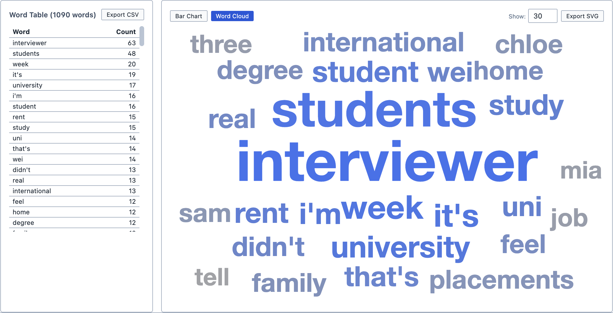
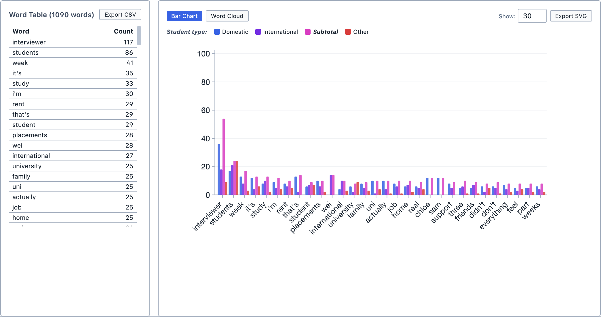

# Word Frequencies

The Word Frequencies tool allows you to see which words appear most often in your documents. It lists every word with the number of times it appears, and shows the most frequent words as a bar chart or a word cloud.

**To open Word Frequencies:**

1. Click the `Analyse` button in the toolbar.

2. Choose `Word Frequencies`.

The tool contains:
- The [Document Selector](/guide/documentselector)
- The [Group By](/guide/grouping) function

## Choosing which words to count

By default, Magnolia counts every word in the selected documents, except for common English words such as "the", "and" and "of". These are known as *stop words*: they appear so often that they would otherwise crowd out everything else.

You can change which words are counted using the two boxes above the results:

| Box | Use |
| --- | --- |
| `Include words` | Counts only the words listed here. Leave it empty to count every word. |
| `Exclude words` | Ignores the words listed here. It starts with the list of stop words, which you can edit. |

Separate the words in either box with commas.

<figure>
     
     <figcaption>The Include words and Exclude words boxes.</figcaption>
</figure>

::: tip
If your documents are full of a word that tells you nothing new (such as "interviewer" in interview transcripts), add it to `Exclude words` to see what else is going on.
:::

## Reading the results

The `Word Table` lists the 200 most frequent words, in order, with the number of times each one appears. The number beside `Word Table` shows how many different words were counted in total.

The chart beside it shows the most frequent words. You can choose between:
- `Bar Chart`, which shows each word as a bar; and,
- `Word Cloud`, which shows each word sized by how often it appears.

<figure>
     
     <figcaption>The word table and bar chart.</figcaption>
</figure>

<figure>
     
     <figcaption>The word cloud.</figcaption>
</figure>

Use the `Show` box to choose how many words appear in the chart (between 5 and 200).

The bar chart shows a separate bar for each document. If you have used [Group By](/guide/grouping), it shows a separate bar for each group instead, so you can compare how often each group uses a word.

<figure>
     
     <figcaption>The bar chart, grouped by the Student type tag category.</figcaption>
</figure>

## Exploring the results

Click a word in the table or the chart to search for it. Every place the word appears is shown in the Query Results pane.

## Saving and exporting

You can save the analysis by clicking `Save Analysis`. It appears in the Analyses Panel. If you make changes later, click `Update Analysis` to save them.

You can export the word table as a spreadsheet by clicking `Export CSV`, and the chart as an image by clicking `Export SVG`.

You can also add the analysis to a [Report](/guide/reports) by dragging it from the Analyses Panel into the report. You can choose whether the report includes the bar chart, the word cloud, or both.
