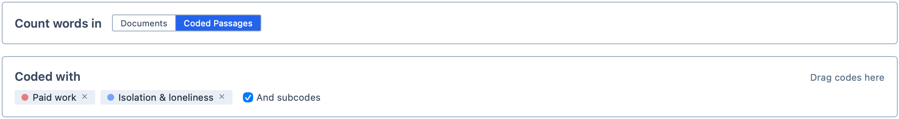
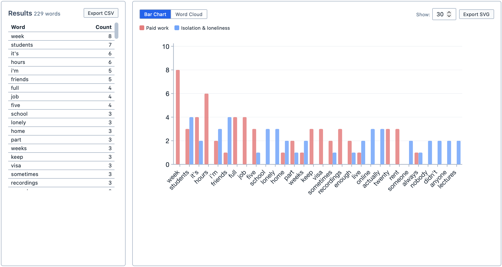
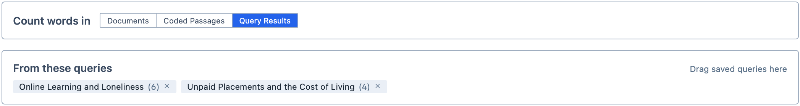
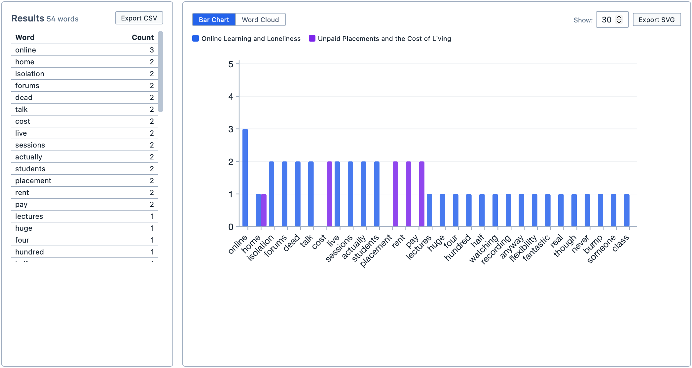
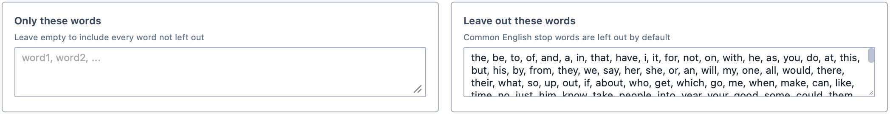
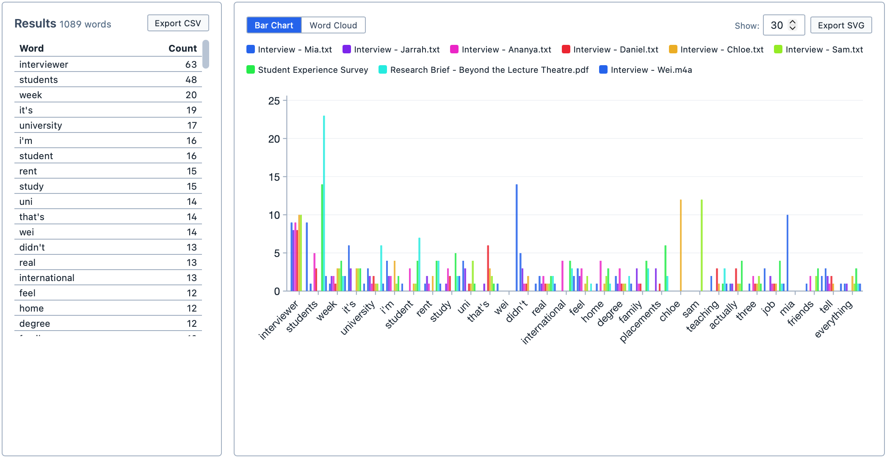
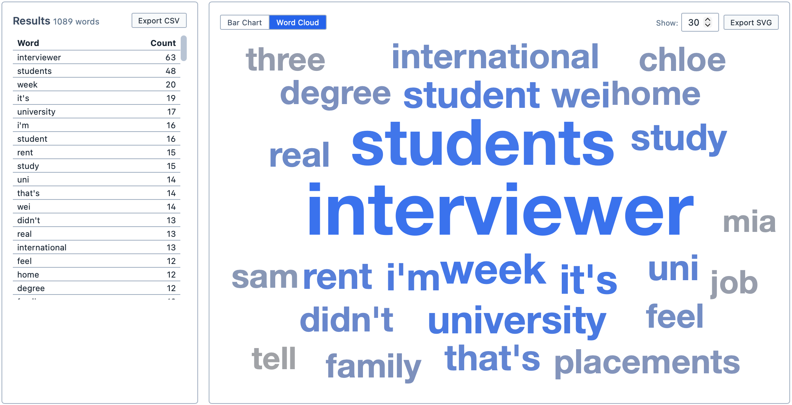
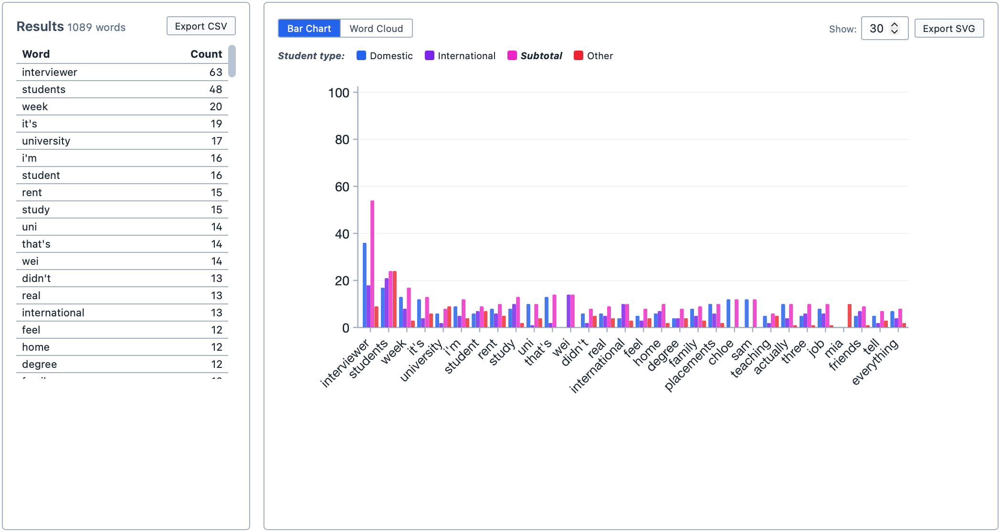

# Word Frequencies

The Word Frequencies tool allows you to see which words appear most often in your documents, in the passages you have coded with particular codes, or in the results of your saved queries. It lists every word with the number of times it appears, and shows the most frequent words as a bar chart or a word cloud.

**To open Word Frequencies:**

1. Click the `Analyse` button in the toolbar.

2. Choose `Word Frequencies`.

The tool contains:
- The `Count words in` choice
- The [Document Selector](/guide/documentselector) (when counting the words in documents or coded passages)
- The [Grouped by](/guide/grouping) function (when counting the words in documents)

## Choosing what to count

Use `Count words in` to choose what Magnolia reads:
- `Documents` counts the words in the whole of each selected document;
- `Coded Passages` counts only the words in the passages you have coded with particular codes; or,
- `Query Results` counts only the words in the results of your saved [queries](/guide/querying).

### Coded passages

Counting coded passages lets you compare how people talk about different things. Think of it as reading only the highlighted parts of your documents. For example, you could compare the words used in passages coded *Belonging & Connection* with those coded *Isolation & loneliness*.

**To count the words in coded passages:**

1. Click `Coded Passages`; and,

2. Drag one or more codes from the Code Browser into the `Coded with` box.

<figure>
     
     <figcaption>Counting the words in the passages coded with two codes.</figcaption>
</figure>

Each code becomes its own bar in the bar chart, in the code's colour, so you can compare the codes word by word. The results table counts the passages of all the codes together.

<figure>
     
     <figcaption>The results, with a bar for each code.</figcaption>
</figure>

| Option | Use |
| --- | --- |
| `And subcodes` | Includes the passages coded with each code's subcodes. It is ticked by default. |

A passage coded with two of your codes counts towards both codes' bars, but only once in the results table. Passages that overlap are only counted once.

The [Document Selector](/guide/documentselector) still applies: only the passages in the selected documents are counted. In surveys, only the passages in the selected questions and respondents are counted.

::: tip
Boxes drawn on PDFs and images have no text, so they can't be counted. Magnolia tells you how many boxes it has left out.
:::

### Query results

Counting query results lets you look at the words in exactly the passages a query finds. For example, a query for the passages where *Unpaid placements & internships* overlaps with *Cost of living & housing* finds where students talk about both at once; counting the words in its results shows how they talk about it.

**To count the words in query results:**

1. Click `Query Results`; and,

2. Drag one or more saved queries from the Saved Queries Panel into the `From these queries` box.

The number beside each query shows how many results it found.

<figure>
     
     <figcaption>Counting the words in the results of two saved queries.</figcaption>
</figure>

Each query searches the documents you chose when you built it, so the Document Selector is hidden. To count the words in different documents, change the query's documents in the [Query Builder](/guide/querying).

Each query becomes its own bar in the bar chart, so you can compare the queries word by word. The results table counts the results of all the queries together, and results that overlap are only counted once.

<figure>
     
     <figcaption>The results, with a bar for each query.</figcaption>
</figure>

The counts update when you change a query, or when your coding changes what it finds.

## Choosing which words to count

By default, Magnolia counts every word in the selected documents, except for common English words such as "the", "and" and "of". These are known as *stop words*: they appear so often that they would otherwise crowd out everything else.

You can change which words are counted using the two boxes above the results:

| Box | Use |
| --- | --- |
| `Only these words` | Counts only the words listed here. Leave it empty to count every word. |
| `Leave out these words` | Ignores the words listed here. It starts with the list of stop words, which you can edit. |

Separate the words in either box with commas.

<figure>
     
     <figcaption>The Only these words and Leave out these words boxes.</figcaption>
</figure>

::: tip
If your documents are full of a word that tells you nothing new (such as "interviewer" in interview transcripts), add it to `Leave out these words` to see what else is going on.
:::

## Reading the results

The `Results` table lists the 200 most frequent words, in order, with the number of times each one appears. The number beside `Results` shows how many different words were counted in total.

The chart beside it shows the most frequent words. You can choose between:
- `Bar Chart`, which shows each word as a bar; and,
- `Word Cloud`, which shows each word sized by how often it appears.

<figure>
     
     <figcaption>The word table and bar chart.</figcaption>
</figure>

<figure>
     
     <figcaption>The word cloud.</figcaption>
</figure>

Use the `Show` box to choose how many words appear in the chart (between 5 and 200).

The bar chart shows a separate bar for each document. If you have used [Grouped by](/guide/grouping), it shows a separate bar for each group instead, so you can compare how often each group uses a word.

<figure>
     
     <figcaption>The bar chart, grouped by the Student type tag category.</figcaption>
</figure>

## Exploring the results

Click a word in the table or the chart to search for it. Every place the word appears is shown in the Query Results pane.

When you are counting coded passages, the search only looks inside those passages. Clicking a code's bar searches only that code's passages.

When you are counting query results, the search only looks inside those results. Clicking a query's bar searches only that query's results.

::: tip
To see which words go *together*, rather than which words are common, use [Word Combinations](/guide/wordcombinations).
:::

## Saving and exporting

You can save the analysis by clicking `Save Analysis`. It appears in the Analyses Panel. If you make changes later, click `Update Analysis` to save them.

You can export the word table as a spreadsheet by clicking `Export CSV`, and the chart as an image by clicking `Export SVG`.

You can also add the analysis to a [Report](/guide/reports) by dragging it from the Analyses Panel into the report. You can choose whether the report includes the bar chart, the word cloud, or both.
